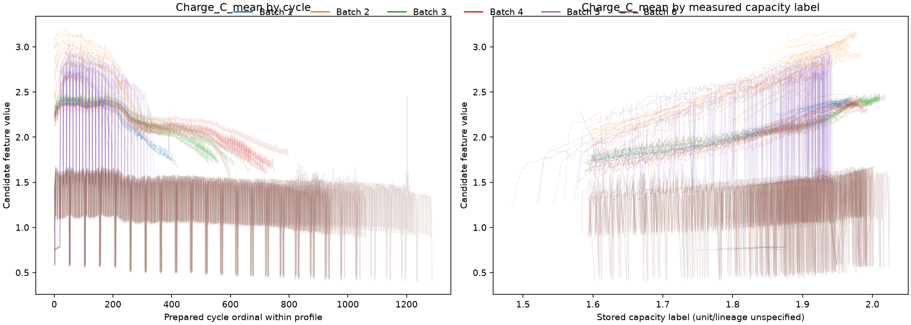
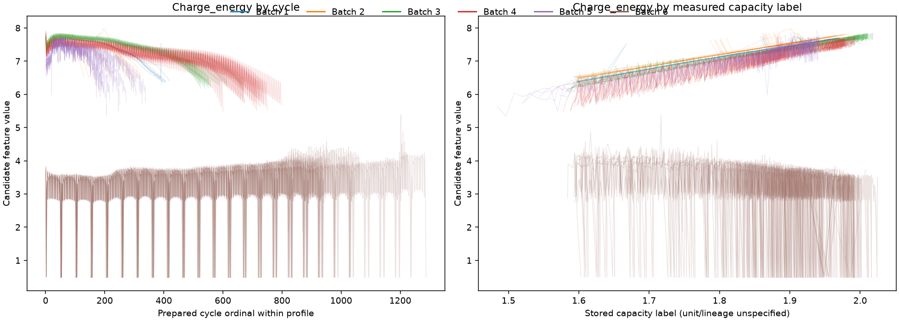
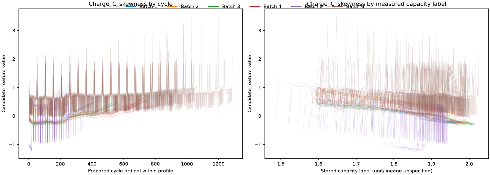

# Member 4 Feature Aging Analysis

## Scope and scientific status

This is a descriptive analysis of candidate features extracted from the available prepared XJTU charge traces. It does not reproduce original SOHbenchmark values. No cycle-to-workbook identity mapping is assumed.

- Prepared profiles: **55**; cycles: **27535**; workbook rows, shown only for context: **26937**.
- Capacity labels are treated as raw measured-capacity proxies, not SOH: the inspected local data do not establish their unit or a per-cell beginning-of-life denominator.
- No per-cell normalization was applied. A first observed capacity is not assumed to be nominal or beginning-of-life capacity.
- All correlations are calculated within profiles before summarizing across profiles; pooled cross-cell correlations are not used to select aging candidates.

## Feature availability

| Feature | Available cycles | Unavailable cycles | Availability | Profiles with any missing values | Minimum profile availability |
|---|---:|---:|---:|---:|---:|
| CC_energy | 27426 | 109 | 0.9960 | 8 | 0.9831 |
| CC_Q | 27426 | 109 | 0.9960 | 8 | 0.9831 |
| CC_t_mean | 27426 | 109 | 0.9960 | 8 | 0.9831 |
| CC_V_mean | 27426 | 109 | 0.9960 | 8 | 0.9831 |
| CC_T_mean | 27426 | 109 | 0.9960 | 8 | 0.9831 |
| CC_V_std | 27426 | 109 | 0.9960 | 8 | 0.9831 |
| CC_T_std | 27426 | 109 | 0.9960 | 8 | 0.9831 |
| CC_V_skewness | 27426 | 109 | 0.9960 | 8 | 0.9831 |
| CC_T_skewness | 27426 | 109 | 0.9960 | 8 | 0.9831 |
| CC_V_kurtosis | 27426 | 109 | 0.9960 | 8 | 0.9831 |
| CC_T_kurtosis | 27426 | 109 | 0.9960 | 8 | 0.9831 |
| CC_CCCT | 27424 | 111 | 0.9960 | 8 | 0.9831 |
| CC_entropy | 27426 | 109 | 0.9960 | 8 | 0.9831 |
| dV_energy | 27102 | 433 | 0.9843 | 8 | 0.9339 |
| dV_Q | 27102 | 433 | 0.9843 | 8 | 0.9339 |
| dV_t_mean | 27102 | 433 | 0.9843 | 8 | 0.9339 |
| dV_V_mean | 27102 | 433 | 0.9843 | 8 | 0.9339 |
| dV_T_mean | 27102 | 433 | 0.9843 | 8 | 0.9339 |
| dV_V_std | 27102 | 433 | 0.9843 | 8 | 0.9339 |
| dV_T_std | 27102 | 433 | 0.9843 | 8 | 0.9339 |
| dV_V_skewness | 27102 | 433 | 0.9843 | 8 | 0.9339 |
| dV_T_skewness | 27102 | 433 | 0.9843 | 8 | 0.9339 |
| dV_V_kurtosis | 27102 | 433 | 0.9843 | 8 | 0.9339 |
| dV_T_kurtosis | 27102 | 433 | 0.9843 | 8 | 0.9339 |
| dV_dV_devide_dt | 27102 | 433 | 0.9843 | 8 | 0.9339 |
| dV_entropy | 27102 | 433 | 0.9843 | 8 | 0.9339 |
| CV_energy | 27535 | 0 | 1.0000 | 0 | 1.0000 |
| CV_Q | 27535 | 0 | 1.0000 | 0 | 1.0000 |
| CV_t_mean | 27535 | 0 | 1.0000 | 0 | 1.0000 |
| CV_C_mean | 27535 | 0 | 1.0000 | 0 | 1.0000 |
| CV_T_mean | 27535 | 0 | 1.0000 | 0 | 1.0000 |
| CV_C_std | 27535 | 0 | 1.0000 | 0 | 1.0000 |
| CV_T_std | 27535 | 0 | 1.0000 | 0 | 1.0000 |
| CV_C_skewness | 27535 | 0 | 1.0000 | 0 | 1.0000 |
| CV_T_skewness | 27535 | 0 | 1.0000 | 0 | 1.0000 |
| CV_C_kurtosis | 27535 | 0 | 1.0000 | 0 | 1.0000 |
| CV_T_kurtosis | 27535 | 0 | 1.0000 | 0 | 1.0000 |
| CV_CVCT | 27535 | 0 | 1.0000 | 0 | 1.0000 |
| CV_entropy | 27535 | 0 | 1.0000 | 0 | 1.0000 |
| dI_energy | 27460 | 75 | 0.9973 | 8 | 0.9450 |
| dI_Q | 27460 | 75 | 0.9973 | 8 | 0.9450 |
| dI_t_mean | 27460 | 75 | 0.9973 | 8 | 0.9450 |
| dI_C_mean | 27460 | 75 | 0.9973 | 8 | 0.9450 |
| dI_T_mean | 27460 | 75 | 0.9973 | 8 | 0.9450 |
| dI_C_std | 27460 | 75 | 0.9973 | 8 | 0.9450 |
| dI_T_std | 27460 | 75 | 0.9973 | 8 | 0.9450 |
| dI_C_skewness | 27460 | 75 | 0.9973 | 8 | 0.9450 |
| dI_T_skewness | 27460 | 75 | 0.9973 | 8 | 0.9450 |
| dI_C_kurtosis | 27460 | 75 | 0.9973 | 8 | 0.9450 |
| dI_T_kurtosis | 27460 | 75 | 0.9973 | 8 | 0.9450 |
| dI_dI_devide_dt | 27460 | 75 | 0.9973 | 8 | 0.9450 |
| dI_entropy | 27460 | 75 | 0.9973 | 8 | 0.9450 |
| Charge_energy | 27535 | 0 | 1.0000 | 0 | 1.0000 |
| Charge_Q | 27535 | 0 | 1.0000 | 0 | 1.0000 |
| Charge_t_mean | 27535 | 0 | 1.0000 | 0 | 1.0000 |
| Charge_V_mean | 27535 | 0 | 1.0000 | 0 | 1.0000 |
| Charge_C_mean | 27535 | 0 | 1.0000 | 0 | 1.0000 |
| Charge_T_mean | 27535 | 0 | 1.0000 | 0 | 1.0000 |
| Charge_C_std | 27535 | 0 | 1.0000 | 0 | 1.0000 |
| Charge_V_std | 27535 | 0 | 1.0000 | 0 | 1.0000 |
| Charge_T_std | 27535 | 0 | 1.0000 | 0 | 1.0000 |
| Charge_C_skewness | 27535 | 0 | 1.0000 | 0 | 1.0000 |
| Charge_V_skewness | 27535 | 0 | 1.0000 | 0 | 1.0000 |
| Charge_T_skewness | 27535 | 0 | 1.0000 | 0 | 1.0000 |
| Charge_C_kurtosis | 27535 | 0 | 1.0000 | 0 | 1.0000 |
| Charge_V_kurtosis | 27535 | 0 | 1.0000 | 0 | 1.0000 |
| Charge_T_kurtosis | 27535 | 0 | 1.0000 | 0 | 1.0000 |

Unavailable candidate values primarily arise when the current candidate phase/window is absent or cannot support its calculation. They do not necessarily indicate missing raw measurements.

## Within-profile trends and capacity relationships

For each feature, Spearman rho was calculated separately against prepared cycle ordinal and the stored capacity label within each profile; the table reports the median and number of profiles with a defined rho. These are associations, not causal effects.

| Feature | Profiles: cycle rho | Median rho vs cycle | Cycle direction consistency | Profiles: capacity rho | Median rho vs capacity | Capacity direction consistency |
|---|---:|---:|---:|---:|---:|---:|
| CC_energy | 55 | -0.9359 | 0.8545 | 55 | 0.9497 | 0.8545 |
| CC_Q | 55 | -0.9355 | 0.8545 | 55 | 0.9592 | 0.8545 |
| CC_t_mean | 55 | -0.9354 | 0.8545 | 55 | 0.9591 | 0.8545 |
| CC_V_mean | 55 | 0.8001 | 0.8545 | 55 | -0.8694 | 0.8545 |
| CC_T_mean | 55 | -0.5549 | 0.7455 | 55 | 0.4696 | 0.8727 |
| CC_V_std | 55 | -0.3739 | 0.7273 | 55 | 0.4563 | 0.6727 |
| CC_T_std | 55 | 0.3429 | 0.9273 | 55 | -0.2899 | 0.9636 |
| CC_V_skewness | 55 | -0.8194 | 0.8545 | 55 | 0.6197 | 0.8545 |
| CC_T_skewness | 55 | 0.4337 | 1.0000 | 55 | -0.3914 | 1.0000 |
| CC_V_kurtosis | 55 | 0.2610 | 0.6364 | 55 | -0.1619 | 0.6000 |
| CC_T_kurtosis | 55 | -0.3041 | 0.8182 | 55 | 0.2594 | 0.8000 |
| CC_CCCT | 55 | -0.9354 | 0.8545 | 55 | 0.9591 | 0.8545 |
| CC_entropy | 55 | -0.2306 | 0.7636 | 55 | 0.1059 | 0.6909 |
| dV_energy | 55 | 0.6017 | 0.8000 | 55 | -0.6473 | 0.8000 |
| dV_Q | 55 | 0.6012 | 0.7818 | 55 | -0.6474 | 0.8000 |
| dV_t_mean | 55 | 0.6012 | 0.7636 | 55 | -0.6474 | 0.8000 |
| dV_V_mean | 55 | -0.3903 | 0.6000 | 55 | 0.4007 | 0.6000 |
| dV_T_mean | 55 | -0.5944 | 0.9091 | 55 | 0.5632 | 1.0000 |
| dV_V_std | 55 | -0.7761 | 1.0000 | 55 | 0.7121 | 1.0000 |
| dV_T_std | 55 | 0.5332 | 1.0000 | 55 | -0.5039 | 1.0000 |
| dV_V_skewness | 55 | 0.4122 | 0.6000 | 55 | -0.4145 | 0.6000 |
| dV_T_skewness | 55 | 0.0670 | 0.7818 | 55 | -0.0646 | 0.7818 |
| dV_V_kurtosis | 55 | 0.5472 | 0.6727 | 55 | -0.5386 | 0.6727 |
| dV_T_kurtosis | 55 | -0.0568 | 0.8364 | 55 | 0.0485 | 0.8182 |
| dV_dV_devide_dt | 55 | -0.6012 | 0.7636 | 55 | 0.6474 | 0.8000 |
| dV_entropy | 55 | -0.3963 | 0.6000 | 55 | 0.4034 | 0.6000 |
| CV_energy | 55 | 0.9725 | 1.0000 | 55 | -0.8815 | 1.0000 |
| CV_Q | 55 | 0.9725 | 1.0000 | 55 | -0.8815 | 1.0000 |
| CV_t_mean | 55 | 0.9132 | 1.0000 | 55 | -0.9405 | 1.0000 |
| CV_C_mean | 55 | -0.3989 | 0.7273 | 55 | 0.5208 | 0.9273 |
| CV_T_mean | 55 | -0.6149 | 0.8000 | 55 | 0.5600 | 0.9091 |
| CV_C_std | 55 | -0.2129 | 0.7273 | 55 | 0.2968 | 0.8727 |
| CV_T_std | 55 | 0.8167 | 0.9818 | 55 | -0.7956 | 1.0000 |
| CV_C_skewness | 55 | 0.3892 | 0.8000 | 55 | -0.4422 | 0.7818 |
| CV_T_skewness | 55 | 0.6714 | 0.9455 | 55 | -0.7028 | 1.0000 |
| CV_C_kurtosis | 55 | 0.3657 | 0.8000 | 55 | -0.4403 | 0.7818 |
| CV_T_kurtosis | 55 | 0.6886 | 0.8909 | 55 | -0.7407 | 0.9818 |
| CV_CVCT | 55 | 0.9132 | 1.0000 | 55 | -0.9405 | 1.0000 |
| CV_entropy | 55 | -0.4800 | 0.8909 | 55 | 0.6011 | 0.9455 |
| dI_energy | 55 | 0.5727 | 0.9636 | 55 | -0.4879 | 0.8545 |
| dI_Q | 55 | 0.5726 | 0.9636 | 55 | -0.4879 | 0.8545 |
| dI_t_mean | 55 | 0.5729 | 0.9636 | 55 | -0.4872 | 0.8545 |
| dI_C_mean | 55 | 0.0048 | 0.5091 | 55 | 0.0024 | 0.5091 |
| dI_T_mean | 55 | -0.5674 | 0.8545 | 55 | 0.5065 | 0.8727 |
| dI_C_std | 55 | 0.0445 | 0.7091 | 55 | -0.0557 | 0.7091 |
| dI_T_std | 55 | 0.3238 | 0.9636 | 55 | -0.2336 | 0.8909 |
| dI_C_skewness | 55 | 0.0112 | 0.5091 | 55 | 0.0172 | 0.5273 |
| dI_T_skewness | 55 | 0.0131 | 0.5818 | 55 | -0.0138 | 0.5273 |
| dI_C_kurtosis | 55 | 0.0040 | 0.5273 | 55 | -0.0048 | 0.5273 |
| dI_T_kurtosis | 55 | -0.0050 | 0.5273 | 55 | 0.0159 | 0.6000 |
| dI_dI_devide_dt | 55 | 0.5729 | 0.9636 | 55 | -0.5009 | 0.8545 |
| dI_entropy | 55 | 0.0274 | 0.5636 | 55 | -0.0109 | 0.5273 |
| Charge_energy | 55 | -0.8834 | 0.8545 | 55 | 0.9628 | 0.8545 |
| Charge_Q | 55 | -0.8905 | 0.8545 | 55 | 0.9608 | 0.8545 |
| Charge_t_mean | 55 | 0.7989 | 0.9636 | 55 | -0.8234 | 1.0000 |
| Charge_V_mean | 55 | 0.8873 | 1.0000 | 55 | -0.9529 | 1.0000 |
| Charge_C_mean | 55 | -0.8934 | 1.0000 | 55 | 0.9643 | 1.0000 |
| Charge_T_mean | 55 | -0.6270 | 0.8182 | 55 | 0.5835 | 0.9273 |
| Charge_C_std | 55 | -0.4871 | 0.9455 | 55 | 0.5562 | 0.8727 |
| Charge_V_std | 55 | -0.7978 | 1.0000 | 55 | 0.8806 | 1.0000 |
| Charge_T_std | 55 | 0.6113 | 0.9818 | 55 | -0.6133 | 1.0000 |
| Charge_C_skewness | 55 | 0.9023 | 1.0000 | 55 | -0.9628 | 1.0000 |
| Charge_V_skewness | 55 | -0.9590 | 1.0000 | 55 | 0.9290 | 1.0000 |
| Charge_T_skewness | 55 | 0.5708 | 1.0000 | 55 | -0.5462 | 1.0000 |
| Charge_C_kurtosis | 55 | 0.4606 | 0.9636 | 55 | -0.5423 | 0.9273 |
| Charge_V_kurtosis | 55 | 0.9646 | 1.0000 | 55 | -0.8783 | 1.0000 |
| Charge_T_kurtosis | 55 | 0.1490 | 0.5636 | 55 | -0.1150 | 0.5636 |

### Candidate features for further investigation

The following are ranked by absolute median within-profile capacity-label rho and require further validation; they are not endorsed predictors.

| Feature | Median within-profile rho vs capacity | Profiles |
|---|---:|---:|
| Charge_C_mean | 0.9643 | 55 |
| Charge_energy | 0.9628 | 55 |
| Charge_C_skewness | -0.9628 | 55 |
| Charge_Q | 0.9608 | 55 |
| CC_Q | 0.9592 | 55 |
| CC_t_mean | 0.9591 | 55 |
| CC_CCCT | 0.9591 | 55 |
| Charge_V_mean | -0.9529 | 55 |
| CC_energy | 0.9497 | 55 |
| CV_t_mean | -0.9405 | 55 |
| CV_CVCT | -0.9405 | 55 |
| Charge_V_skewness | 0.9290 | 55 |
| CV_Q | -0.8815 | 55 |
| CV_energy | -0.8815 | 55 |
| Charge_V_std | 0.8806 | 55 |

## Batch/profile distribution differences

Feature medians by batch are stored in the JSON summary. Batch differences are descriptive and may combine protocol effects with cell-cohort and other differences.

| Batch | Profiles | Cycles | Capacity-label range across profiles (min of per-cell minima to max of maxima) |
|---:|---:|---:|---:|
| 1 | 8 | 3211 | 1.581 to 1.974 |
| 2 | 15 | 3727 | 1.594 to 1.984 |
| 3 | 8 | 4608 | 1.584 to 2.018 |
| 4 | 8 | 5670 | 1.578 to 1.993 |
| 5 | 8 | 1975 | 1.484 to 1.9424 |
| 6 | 8 | 8344 | 1.584 to 2.0244 |

## Feature redundancy

Pairs are flagged when the median within-profile Spearman rho has absolute value at least 0.9 across at least 10 profiles. This screens redundant candidate outputs; it does not identify a causal mechanism.

| Feature A | Feature B | Median within-profile rho | Profiles | Direction consistency |
|---|---|---:|---:|---:|
| CC_t_mean | CC_CCCT | 1.0000 | 55 | 1.0000 |
| dV_t_mean | dV_dV_devide_dt | -1.0000 | 55 | 1.0000 |
| CV_t_mean | CV_CVCT | 1.0000 | 55 | 1.0000 |
| dI_t_mean | dI_dI_devide_dt | 1.0000 | 55 | 1.0000 |
| CV_energy | CV_Q | 1.0000 | 55 | 1.0000 |
| dI_energy | dI_Q | 1.0000 | 55 | 1.0000 |
| dV_Q | dV_t_mean | 1.0000 | 55 | 1.0000 |
| dV_Q | dV_dV_devide_dt | -1.0000 | 55 | 1.0000 |
| dV_energy | dV_Q | 1.0000 | 55 | 1.0000 |
| CC_Q | CC_t_mean | 1.0000 | 55 | 1.0000 |
| CC_Q | CC_CCCT | 1.0000 | 55 | 1.0000 |
| dV_energy | dV_t_mean | 1.0000 | 55 | 1.0000 |
| dV_energy | dV_dV_devide_dt | -1.0000 | 55 | 1.0000 |
| dI_energy | dI_t_mean | 1.0000 | 55 | 1.0000 |
| dI_Q | dI_t_mean | 1.0000 | 55 | 1.0000 |
| dI_energy | dI_dI_devide_dt | 0.9999 | 55 | 1.0000 |
| dI_Q | dI_dI_devide_dt | 0.9999 | 55 | 1.0000 |
| Charge_C_mean | Charge_C_skewness | -0.9997 | 55 | 1.0000 |
| CC_energy | CC_Q | 0.9997 | 55 | 1.0000 |
| CC_energy | CC_t_mean | 0.9990 | 55 | 1.0000 |
| CC_energy | CC_CCCT | 0.9990 | 55 | 1.0000 |
| CV_C_skewness | CV_C_kurtosis | 0.9989 | 55 | 1.0000 |
| Charge_energy | Charge_Q | 0.9989 | 55 | 1.0000 |
| CC_V_mean | Charge_V_std | -0.9957 | 55 | 0.8545 |
| Charge_V_skewness | Charge_V_kurtosis | -0.9939 | 55 | 1.0000 |
| dV_V_mean | dV_V_skewness | -0.9922 | 55 | 1.0000 |
| Charge_V_mean | Charge_C_skewness | 0.9916 | 55 | 1.0000 |
| Charge_V_mean | Charge_C_mean | -0.9879 | 55 | 1.0000 |
| CV_t_mean | Charge_C_mean | -0.9877 | 55 | 1.0000 |
| CV_CVCT | Charge_C_mean | -0.9877 | 55 | 1.0000 |
| CC_Q | Charge_Q | 0.9876 | 55 | 1.0000 |
| CC_t_mean | Charge_Q | 0.9876 | 55 | 1.0000 |
| CC_CCCT | Charge_Q | 0.9876 | 55 | 1.0000 |
| CV_t_mean | Charge_C_skewness | 0.9870 | 55 | 1.0000 |
| CV_CVCT | Charge_C_skewness | 0.9870 | 55 | 1.0000 |
| dV_V_mean | dV_entropy | 0.9868 | 55 | 1.0000 |
| CC_Q | Charge_energy | 0.9858 | 55 | 1.0000 |
| CC_t_mean | Charge_energy | 0.9858 | 55 | 1.0000 |
| CC_CCCT | Charge_energy | 0.9858 | 55 | 1.0000 |
| CC_energy | Charge_Q | 0.9854 | 55 | 1.0000 |
| CC_energy | Charge_energy | 0.9842 | 55 | 1.0000 |
| CV_T_mean | Charge_T_mean | 0.9772 | 55 | 1.0000 |
| dV_V_skewness | dV_entropy | -0.9753 | 55 | 1.0000 |
| dV_T_mean | Charge_T_mean | 0.9743 | 55 | 1.0000 |
| CV_T_mean | dI_T_mean | 0.9728 | 55 | 1.0000 |
| CV_t_mean | Charge_V_mean | 0.9727 | 55 | 1.0000 |
| CV_CVCT | Charge_V_mean | 0.9727 | 55 | 1.0000 |
| Charge_V_mean | Charge_V_std | -0.9716 | 55 | 1.0000 |
| CC_t_mean | Charge_C_skewness | -0.9686 | 55 | 1.0000 |
| CC_CCCT | Charge_C_skewness | -0.9686 | 55 | 1.0000 |
| CC_V_mean | Charge_V_mean | 0.9664 | 55 | 0.8545 |
| CV_T_skewness | CV_T_kurtosis | 0.9659 | 55 | 1.0000 |
| CC_Q | Charge_C_mean | 0.9643 | 55 | 1.0000 |
| CC_Q | Charge_C_skewness | -0.9643 | 55 | 0.8545 |
| CC_t_mean | Charge_C_mean | 0.9643 | 55 | 0.8182 |
| CC_CCCT | Charge_C_mean | 0.9643 | 55 | 0.8182 |
| CV_C_skewness | CV_entropy | -0.9610 | 55 | 1.0000 |
| CC_t_mean | Charge_V_mean | -0.9610 | 55 | 1.0000 |
| CC_CCCT | Charge_V_mean | -0.9610 | 55 | 1.0000 |
| CC_energy | Charge_C_mean | 0.9606 | 55 | 1.0000 |
| CC_energy | Charge_C_skewness | -0.9605 | 55 | 0.8545 |
| CC_Q | Charge_V_mean | -0.9589 | 55 | 0.8545 |
| CV_energy | Charge_V_kurtosis | 0.9571 | 55 | 1.0000 |
| CV_Q | Charge_V_kurtosis | 0.9571 | 55 | 1.0000 |
| CV_T_std | Charge_T_std | 0.9568 | 55 | 1.0000 |
| dI_C_mean | dI_entropy | 0.9560 | 55 | 1.0000 |
| CC_t_mean | Charge_V_skewness | 0.9555 | 55 | 1.0000 |
| CC_CCCT | Charge_V_skewness | 0.9555 | 55 | 1.0000 |
| CC_T_mean | Charge_T_mean | 0.9528 | 55 | 1.0000 |
| CC_energy | Charge_V_mean | -0.9520 | 55 | 0.8545 |
| Charge_Q | Charge_C_mean | 0.9520 | 55 | 1.0000 |
| Charge_Q | Charge_C_skewness | -0.9518 | 55 | 0.8545 |
| CC_energy | Charge_V_skewness | 0.9510 | 55 | 0.8545 |
| CV_Q | Charge_V_skewness | -0.9494 | 55 | 1.0000 |
| CV_energy | Charge_V_skewness | -0.9494 | 55 | 1.0000 |
| Charge_C_skewness | Charge_V_skewness | -0.9492 | 55 | 1.0000 |
| dI_C_mean | dI_C_skewness | -0.9492 | 55 | 1.0000 |
| CC_T_mean | dV_T_mean | 0.9491 | 55 | 1.0000 |
| CV_C_kurtosis | CV_entropy | -0.9485 | 55 | 1.0000 |
| dI_T_mean | Charge_T_mean | 0.9464 | 55 | 1.0000 |
| dV_T_mean | dI_T_mean | 0.9426 | 55 | 1.0000 |
| Charge_Q | Charge_V_mean | -0.9426 | 55 | 0.8545 |
| Charge_energy | Charge_C_mean | 0.9425 | 55 | 1.0000 |
| Charge_energy | Charge_C_skewness | -0.9423 | 55 | 0.8545 |
| CC_V_mean | Charge_C_skewness | 0.9417 | 55 | 0.8545 |
| Charge_V_std | Charge_C_skewness | -0.9392 | 55 | 1.0000 |
| Charge_V_mean | Charge_V_skewness | -0.9375 | 55 | 1.0000 |
| CC_Q | Charge_V_skewness | 0.9353 | 55 | 0.8545 |
| CV_t_mean | Charge_V_skewness | -0.9317 | 55 | 1.0000 |
| CV_CVCT | Charge_V_skewness | -0.9317 | 55 | 1.0000 |
| CC_V_mean | Charge_C_mean | -0.9283 | 55 | 1.0000 |
| Charge_C_std | Charge_C_kurtosis | -0.9281 | 55 | 1.0000 |
| Charge_energy | Charge_V_mean | -0.9276 | 55 | 0.8545 |
| dV_T_mean | CV_T_mean | 0.9275 | 55 | 1.0000 |
| CC_t_mean | CV_Q | -0.9266 | 55 | 0.9818 |
| CC_CCCT | CV_Q | -0.9266 | 55 | 0.9818 |
| CC_t_mean | CV_energy | -0.9266 | 55 | 0.9818 |
| CC_CCCT | CV_energy | -0.9266 | 55 | 0.9818 |
| Charge_C_mean | Charge_V_std | 0.9261 | 55 | 1.0000 |
| CV_t_mean | Charge_t_mean | 0.9238 | 55 | 1.0000 |
| CV_CVCT | Charge_t_mean | 0.9238 | 55 | 1.0000 |
| Charge_C_skewness | Charge_V_kurtosis | 0.9210 | 55 | 1.0000 |
| CC_V_kurtosis | CC_entropy | -0.9189 | 55 | 0.9636 |
| CC_Q | CV_t_mean | -0.9189 | 55 | 0.8545 |
| CC_Q | CV_CVCT | -0.9189 | 55 | 0.8545 |
| CC_t_mean | CV_t_mean | -0.9189 | 55 | 0.8545 |
| CC_t_mean | CV_CVCT | -0.9189 | 55 | 0.8545 |
| CC_CCCT | CV_t_mean | -0.9189 | 55 | 0.8545 |
| CC_CCCT | CV_CVCT | -0.9189 | 55 | 0.8545 |
| CV_Q | CV_t_mean | 0.9180 | 55 | 1.0000 |
| CV_Q | CV_CVCT | 0.9180 | 55 | 1.0000 |
| CV_energy | CV_t_mean | 0.9180 | 55 | 1.0000 |
| CV_energy | CV_CVCT | 0.9180 | 55 | 1.0000 |
| CC_t_mean | Charge_V_kurtosis | -0.9162 | 55 | 1.0000 |
| CC_CCCT | Charge_V_kurtosis | -0.9162 | 55 | 1.0000 |
| CC_Q | CV_energy | -0.9142 | 55 | 0.8545 |
| CC_Q | CV_Q | -0.9142 | 55 | 0.8545 |
| CC_energy | CV_t_mean | -0.9139 | 55 | 0.8545 |
| CC_energy | CV_CVCT | -0.9139 | 55 | 0.8545 |
| CC_energy | CV_Q | -0.9139 | 55 | 0.8545 |
| CC_energy | CV_energy | -0.9139 | 55 | 0.8545 |
| CV_C_mean | CV_C_std | 0.9106 | 55 | 1.0000 |
| CC_V_mean | CV_t_mean | 0.9083 | 55 | 0.8545 |
| CC_V_mean | CV_CVCT | 0.9083 | 55 | 0.8545 |
| dI_C_skewness | dI_entropy | -0.9079 | 55 | 1.0000 |
| Charge_C_mean | Charge_V_skewness | 0.9069 | 55 | 0.9636 |
| CC_energy | Charge_V_kurtosis | -0.9059 | 55 | 0.8545 |
| Charge_V_mean | Charge_V_kurtosis | 0.9058 | 55 | 1.0000 |
| CV_t_mean | Charge_V_std | -0.9047 | 55 | 1.0000 |
| CV_CVCT | Charge_V_std | -0.9047 | 55 | 1.0000 |
| CC_t_mean | Charge_V_std | 0.9039 | 55 | 1.0000 |
| CC_CCCT | Charge_V_std | 0.9039 | 55 | 1.0000 |
| CC_V_mean | Charge_Q | -0.9026 | 55 | 1.0000 |
| CC_Q | Charge_V_std | 0.9005 | 55 | 0.8545 |

## Representative trajectories

### Charge_C_mean, Charge_energy, Charge_C_skewness



Two panels show the candidate feature against per-profile cycle ordinal and against the stored capacity label. Lines are un-normalized, and color denotes batch.

### Charge_C_mean, Charge_energy, Charge_C_skewness



Two panels show the candidate feature against per-profile cycle ordinal and against the stored capacity label. Lines are un-normalized, and color denotes batch.

### Charge_C_mean, Charge_energy, Charge_C_skewness



Two panels show the candidate feature against per-profile cycle ordinal and against the stored capacity label. Lines are un-normalized, and color denotes batch.

## Interpretation limits

- The capacity field is not verified SOH; target units and initial capacity are not established. No per-cell capacity normalization or SOH conversion was performed.
- Correlations, direction consistency, feature rankings, and between-batch differences are exploratory and do not prove causality or predictive value.
- Prepared-array cycle ordinal is not asserted to identify the corresponding workbook row.
- Candidate formulas and phase windows remain unverified against the original feature generator.

## Reproducibility

From the repository root:

```powershell
.\.venv\Scripts\python.exe -m scripts.member4_xjtu.aging_analysis
```

The script writes this report, its JSON summary, and trajectory plots under `reports/member4/`.
