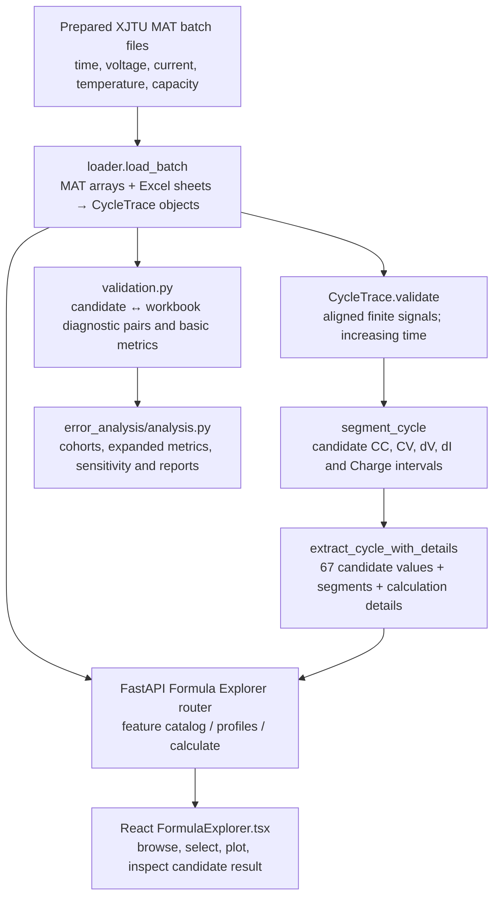

# Member 4 Code Mastery Guide

## How to use this guide

This guide explains the implementation found in the repository as a beginner-friendly walkthrough. Read it in order, and keep the code open while practicing. The math and thresholds below describe what the current **candidate** code computes; they do not establish the formulas used to generate the original Excel workbooks.

### Evidence labels used here

- **Implemented behavior:** directly visible in the inspected source or tests.
- **Candidate assumption:** a reproducible choice made by the current extractor.
- **Unverified science:** a fact that cannot be concluded from code or numerical agreement alone.

Current research conclusions remain: **0/67 original formulas source-verified; 63 candidate/unverified; 4 entropy definitions unavailable; and 0 authoritative cycle-to-workbook identity pairs.** Validation residuals are diagnostic. Do not remove these caveats in a viva.

## Big picture: data flow

### What the diagram does not imply

The validation branch does **not** make the API's selected MAT cycle correspond to an Excel row. `loader.py` gives local ordinal names to profiles/cycles; `validation.py` uses positional matching for equal counts and a capacity-label heuristic for some unequal counts. Both are explicitly unverified/diagnostic. The Formula Explorer endpoint calculates from the selected MAT ordinal and does not return a joined workbook row.

## Beginner programming concepts you will see

### Python functions, arguments, and return values

A function packages steps under a name. For example, `load_batch(batch, data_root)` accepts a batch number and optional folder path, then returns two objects: a list of profiles and a mapping of workbook sheet names to pandas DataFrames. A call such as `profiles, sheets = load_batch(1)` unpacks that pair into two variables.

Functions may have defaults, such as `data_root=DEFAULT_DATA_ROOT`, and type annotations, such as `batch: int`. An annotation documents the intended type and helps tools; it does not by itself validate every value at runtime.

### Classes and dataclasses

A class groups related data and behavior. `CycleTrace` is a frozen dataclass: it stores the cycle's batch/profile/index and signal arrays, and its `validate()` method checks them. `TimeInterval` stores two time boundaries and validates them when created. `PhaseSegment` stores a named candidate region, its intervals, selection explanation, and a Boolean mask.

“Frozen” prevents reassigning dataclass fields after creation; it does not make the contents of a NumPy array deeply immutable.

### Lists, tuples, dictionaries, and sets

- A **list** is ordered and mutable: `profiles` is a list of profiles, and each profile is a list of cycles.
- A **tuple** is ordered and normally used for fixed configuration: `GROUPS` and a segment's interval collection are tuples.
- A **dictionary** maps a key to a value: `values["CC_energy"]` stores one feature result; `segments["CC"]` stores a segment object.
- A **set** stores unique values: the code uses sets for validation of feature scopes and missing column names.

List indexing starts at zero in Python. The UI/API cycle selectors are one-based; the API converts them to zero-based Python indices with `cycles[cycle - 1]`.

### NumPy and pandas

NumPy represents numerical arrays and provides operations used by this pipeline: `np.asarray`, `np.diff`, `np.percentile`, `np.flatnonzero`, `np.interp`, `np.linspace`, `np.mean`, `np.histogram`, and `np.isfinite`. Many operations work on an entire array at once instead of a Python loop.

Pandas represents spreadsheet tables as DataFrames. `pd.read_excel(..., sheet_name=None)` returns a dictionary-like collection of all sheets. A column is selected with `frame["label"]`; a row by integer position uses `frame.iloc[row_index]`; columns are listed in `frame.columns`.

### Exceptions and guards

`raise ValueError(...)` stops execution when input violates a rule. `try`/`except` is used at the API boundary to translate a missing file into a user-facing HTTP status. A guard such as `if not segment.intervals: return {}` handles an unavailable candidate interval explicitly instead of calculating with invented values.

### TypeScript and React

TypeScript adds types to JavaScript values. A type like `type Profile = { name: string; cycle_count: number }` documents the shape expected from the API. A union such as `type FeatureGroup = (typeof GROUPS)[number]` restricts the group to one of the strings in `GROUPS`.

React components return UI markup written in JSX. `useState` stores values that change during interaction; `useEffect` performs work such as fetching data; `useMemo` caches a derived value until its dependencies change. State updates cause the component to render again. The component uses typed response objects to describe API data, but its generic `fetchJson<T>` ultimately casts the parsed payload to `T`; that cast is not full runtime schema validation.

## 1. `feature_definitions.py` — the feature catalog

Source: [`feature_definitions.py`](../scripts/member4_xjtu/feature_definitions.py)

### Why it exists

This module provides one canonical ordering and description for the 67 workbook feature names. Other modules import that ordering rather than independently rebuilding feature lists. It also labels the equations as candidates and stores assumptions so the UI and reports can explain their status.

### Important names and data

- `GROUPS`: fixed ordered tuple `("CC", "dV", "CV", "dI", "Charge")`.
- `STATISTICS`: `mean`, `std`, `skewness`, and `kurtosis`.
- `CHANNELS`: maps each group to name suffixes and signal labels. For instance, CC maps `V` to voltage and `T` to temperature; CV maps `C` to current and `T` to temperature.
- `FeatureDefinition`: frozen dataclass containing a feature's name, group, candidate signal/segment/formula/unit, evidence class, status, and assumptions.
- `_feature_names_for_group(group)`: constructs ordered feature names for one group.
- `FEATURE_NAMES`: concatenates the five per-group lists into a tuple, then raises at import time if it is not exactly 67 unique names.
- `feature_definitions()`: builds the 67 `FeatureDefinition` instances.

### How the schema is built

The first three names for a group are energy, `Q`, and `t_mean`. A loop adds four statistics for each channel assigned to that group. For Charge, mean uses V, C, and T; the other statistics are deliberately ordered C, V, T in this code. A final branch adds the group-specific duration/rate and entropy names. Four groups each end up with 13 names; Charge has 15.

`FeatureDefinition.as_dict()` uses `dataclasses.asdict` to turn a definition into a regular dictionary, useful when building JSON-like API responses.

### What its labels mean

Most definitions receive the status string:

> Original formula implementation not located; candidate approximation only.

Entropy definitions instead say the original formula is unknown and identify the 16-bin calculation as a diagnostic proxy. The values `standard_physical_candidate` and `name_supported_candidate` describe why a candidate interpretation was chosen; neither means “source verified.”

### Connections and viva points

`extractor.py` uses `CHANNELS`, `FEATURE_NAMES`, and `GROUPS` to compute and order values. `validation.py` checks workbook column order against `FEATURE_NAMES`. The API serializes `feature_definitions()` into the Formula Explorer catalog.

**Viva sentence:** “This file is the schema and candidate-metadata source of truth for our implementation. It defines names and assumptions, not the original workbook equations.”

**Beginner analogy:** It is like a menu: it lists the available items and descriptions, but it does not prove what recipe a different kitchen used.

## 2. `loader.py` — turning files into cycle objects

Source: [`loader.py`](../scripts/member4_xjtu/loader.py)
Related data model: [`models.py`](../scripts/member4_xjtu/models.py)

### Why it exists

It reads the prepared MAT charge data and Excel feature workbook for one batch, converts signal fields into consistent NumPy arrays, and returns structured cycle and sheet data to downstream code.

### Main functions

- `_as_items(value)`: uses `np.atleast_1d` and `list` so scalar or array-like MATLAB values can be iterated uniformly.
- `_array_field(raw_cycle, name)`: gets a named MAT field, fails if missing, converts it to float64, and flattens it to one dimension.
- `_capacity_label(raw_cycle)`: reads the capacity field, requires at least one finite value, and returns the first as a Python float.
- `load_batch(batch, data_root=DEFAULT_DATA_ROOT)`: validates the batch range and file presence; reads MAT and all workbook sheets; constructs `CycleTrace` objects; checks profile/sheet count and required labels; returns `(profiles, sheets)`.

### Step by step

1. `Path` objects construct paths such as `charge/batch-1.mat` and `handcraft_features/batch-1_features.xlsx`.
2. The function checks both paths with `is_file()` and raises `FileNotFoundError` with the missing path if necessary.
3. SciPy `loadmat` loads the MAT file. The loader requires a top-level `battery` field.
4. Pandas `read_excel(..., sheet_name=None)` reads all workbook sheets into named DataFrames.
5. A profile-count mismatch between the MAT battery array and workbook sheets raises `ValueError`. This is a count consistency check, **not** proof the profile orders identify the same physical batteries.
6. Nested `enumerate(..., start=1)` loops assign local `SheetN` and one-based `cycle_index` ordinals. Those are created here; the observed prepared cycles do not contain authoritative IDs that this code can recover.
7. Four fields become arrays, the scalar capacity becomes a float, and `trace.validate()` checks the result.
8. Each workbook sheet must contain a `label` column. The loader does not validate all feature columns here; `validation.py` performs that check.

### `CycleTrace` and validation

`CycleTrace` stores metadata and arrays. Its `validate()` method requires matching lengths, at least two samples, finite channel values, strictly increasing time, and finite capacity. `TimeInterval` rejects non-finite or non-increasing boundaries. `PhaseSegment.is_disjoint` is a property that returns whether there is more than one interval.

### What it does not do

It does not resample or denoise the traces, recover source cycle IDs, match a workbook row, or explain how the prepared 128-sample traces came from the dataset's stated acquisition sampling. Do not tell an examiner that the loader performs this missing preprocessing.

**Viva sentence:** “The loader converts prepared files into validated `CycleTrace` objects; its profile and cycle numbers are local ordinals, not verified workbook identities.”

**Beginner analogy:** It is a careful unpacker and labeler: it opens boxes and checks each item is usable, but it cannot prove that two boxes with similar labels contain the same physical object.

## 3. `segments.py` — candidate phase windows

Source: [`segments.py`](../scripts/member4_xjtu/segments.py)

### Why it exists

Feature calculations need a time interval or intervals over which to operate. This module turns each cycle's voltage/current signals into explicit candidate CC, CV, dV, dI, and full-charge regions, along with evidence notes and a selected-sample mask.

### `SegmentationPolicy`

The dataclass provides these current defaults:

| Setting | Default | Meaning in this implementation |
|---|---:|---|
| `cc_method` | `adaptive_candidate` | Choose adaptive or author-helper-style CC selection. |
| `cc_voltage_cutoff_v` | 4.199 V | CC requires voltage at or below this value. |
| `cc_current_fixed_a` | 3.9 A | Threshold used only by the optional author-documented mode. |
| `adaptive_current_fraction` | 0.975 | Multiplier on the cycle's 95th-percentile current in default CC mode. |
| `cv_voltage_threshold_v` | 4.199 V | Rising voltage crossing used to start candidate CV. |
| `dv_voltage_range_v` | 3.9–4.0 V | Candidate rising voltage window. |
| `di_current_range_a` | 1.0–0.9 A | Candidate falling current window. |

`__post_init__` checks that the CC mode is supported and thresholds have the expected ordering/range. Dataclass validation is called at construction time.

### Helper functions

- `_crossing_time(...)`: searches for a rising or falling threshold crossing in a bounded time range. When a signal crosses between two stored samples, it linearly interpolates the crossing time. It returns `None` if there is no crossing.
- `_mask_runs(mask)`: finds continuous runs of `True` values. `np.flatnonzero` finds selected indices, `np.diff` detects gaps, and `np.split` separates runs.
- `_mask_intervals(...)`: converts selected sample runs to `TimeInterval` objects, refining boundaries with interpolated threshold crossings where possible. It keeps multiple runs separate.
- `_phase(...)`: constructs a `PhaseSegment` and a Boolean mask over original time samples.
- `_threshold_window(...)`: requires exactly one parent interval, locates start and end crossings in order, and returns an unavailable segment with a note if either crossing is absent or invalid.
- `segment_cycle(cycle, policy)`: validates the cycle and returns all five group segments in a dictionary keyed by group name.

### `segment_cycle` logic

1. **CC:** In adaptive mode, current threshold is `0.975 × percentile_95(current)`; in helper mode it is 3.9 A. Both require voltage ≤4.199 V. Adjacent selected sample runs are extracted and are not gap-bridged.
2. **CV:** Find the first rising crossing of 4.199 V over the entire trace; candidate CV ends at the final stored time.
3. **dV:** Inside one CC interval, find rising 3.9 V then rising 4.0 V.
4. **dI:** Inside one CV interval, find falling 1.0 A then falling 0.9 A.
5. **Charge:** Use one interval from the first to last stored time.

The author helper documents a related CC/CV sample selector, not the exact workbook feature-generation rule. The dV and dI windows are candidate assumptions. All interval evidence strings preserve this distinction.

### Viva points

Explain why the code interpolates threshold times: a threshold may fall between recorded samples. Explain why it keeps separated CC runs separate: silently joining gaps would invent an interval. Missing threshold crossings produce empty intervals instead of fabricated phases.

**Beginner analogy:** It is like drawing highlighted sections on a chart according to explicit rules. The highlighted regions are our reproducible interpretation, not labels supplied by the workbook author.

## 4. `extractor.py` — compute candidate values

Source: [`extractor.py`](../scripts/member4_xjtu/extractor.py)

### Why it exists

This is the numerical core. It takes one validated cycle, applies candidate segments, calculates up to 67 feature values, and optionally records intermediate values for explanation in the UI.

### Main functions

- `_interval_arrays(cycle, interval, dense)`: creates time points and linearly interpolates voltage/current/temperature. When `dense=False`, it uses the interval boundaries plus stored interior times. When `dense=True`, it uses 257 equally spaced times.
- `_moments(values)`: calculates mean, central moments, standard deviation, skewness, and Pearson kurtosis.
- `_entropy_proxy(values)`: calculates the diagnostic histogram entropy and returns bin-level details.
- `_trapezoid_details(times, values)`: computes trapezoid panels over each timestamp difference and returns both the integral sum and per-panel diagnostics.
- `_features_for_segment(...)`: computes the common features for a group and its group-specific duration/rate/entropy values.
- `extract_cycle_with_details(cycle, policy)`: returns `(values, segments, calculation_details)`.
- `extract_cycle(cycle, policy)`: convenience wrapper returning only `(values, segments)`.

### Array and integration details

`np.interp` estimates signal values at exact candidate boundaries. Native integration points include those boundaries and all stored points strictly inside them. For successive points:

`panel = Δt × (y_left + y_right) / 2`

For energy, `y` is `V × I`; for charge, `y` is `I`. Time is in minutes, so the sum is divided by 60 to convert to hours. The candidate results are thus expressed in Wh and Ah if voltage/current units are V/A. This describes the current implementation; the workbook's sign and integration conventions are unknown.

### Statistics and multi-interval behavior

The code creates 257 linear time points for each interval, evaluates the channels at those points, then concatenates the interval arrays. Elapsed time is reset by subtracting each interval's own first time before concatenation. Consequently, if a segment has multiple intervals, each receives 257 points regardless of duration: the simple moment calculation weights intervals equally by grid count, not automatically by duration. This is a candidate implementation property worth knowing for a detailed viva.

`_moments` computes:

- mean: average of the values;
- variance: average squared deviation (population convention);
- standard deviation: square root of that variance;
- skewness: third central moment divided by variance to the \(3/2\) power;
- Pearson kurtosis: fourth central moment divided by variance squared (not Fisher excess kurtosis).

When variance is no larger than machine epsilon, this code returns zero standard deviation and zero standardized moments. Standardized moments are mathematically undefined for exact zero variance; zero is the implementation's explicit fallback, not a universal or verified benchmark convention.

### Group-specific values and candidate units

| Group | Count | Candidate interval/signal interpretation | Main outputs and units |
|---|---:|---|---|
| CC | 13 | Adaptive current plateau and voltage ceiling by default; V and T statistics | energy (Wh), charge (Ah), elapsed-time mean (min), V/T means and standard deviations (V/°C), skewness/kurtosis (dimensionless), CC duration (min), voltage-histogram entropy proxy (nats). |
| dV | 13 | Rising 3.9–4.0 V window within candidate CC; V and T statistics | Same common integral/statistics families; endpoint voltage rate (V/min); voltage entropy proxy (nats). |
| CV | 13 | From rising 4.199 V crossing to stored trace end; current and T statistics | Same common families; CV duration (min); current entropy proxy (nats). |
| dI | 13 | Falling 1.0–0.9 A window within candidate CV; current and T statistics | Same common families; endpoint current rate (A/min); current entropy proxy (nats). |
| Charge | 15 | Full stored trace; V, C (current), and T statistics | energy (Wh), charge (Ah), elapsed-time mean (min), channel means/stds in V/A/°C, skewness/kurtosis dimensionless. No group entropy/duration/rate special feature. |

The CC/dV/CV/dI common families are three values for energy, Q, and time; eight statistics (two channels × four statistics); and two group-specific outputs, totaling 13. Charge has three common values, twelve statistics (three channels × four statistics), totaling 15.

### Entropy, duration, and rates

Entropy calls `np.histogram(values, bins=16)`, discards zero-count bins, normalizes counts into probabilities, and computes `-Σ p ln(p)`. It uses voltage for CC/dV and current for CV/dI. It reports nats. The original workbook entropy signal, estimator, bins, normalization, and logarithm base have not been established.

CCCT/CVCT are calculated from interval duration totals, but the feature value is `None` when the phase is disjoint. dV/dI rates use linearly interpolated endpoint signal differences divided by interval duration; they are secant rates over the candidate window, not per-sample derivatives.

### Calculation-detail dictionary

When details are requested, each feature's dictionary records its operation and candidate result. Integration includes panel values and the divide-by-60 conversion; moment statistics include moment values; entropy includes bin edges/counts/probabilities/contributions; durations and rates include interval boundaries. This supports transparency in Formula Explorer; it does not add source provenance.

**Beginner analogy:** The extractor is a calculator with a detailed paper trail. It shows every candidate step, but a detailed calculation is not proof that the chosen recipe is the benchmark author's recipe.

## 5. `validation.py` — compare candidate output with workbook rows

Source: [`validation.py`](../scripts/member4_xjtu/validation.py)

### Why it exists

It applies the candidate extractor to cycles, pairs outputs with Excel rows using explicitly labeled methods, checks the workbook feature schema, computes basic residual metrics, and writes a CSV and Markdown report.

### Pairing functions

- `_unique_monotone_capacity_pairs(cycles, labels)`: scans workbook labels in order and looks for exactly one remaining cycle capacity within `1e-6`. A unique candidate is paired and the search cursor advances. Zero candidates are unmatched; multiple candidates are both ambiguous and unmatched.
- `_profile_pairs(cycles, frame)`: converts labels to finite floats. Equal counts are paired by equal index with method `positional_unverified_equal_counts`. If there are fewer cycles than rows, all rows are unmatched. Otherwise it invokes the capacity helper and marks the result diagnostic.

Neither method yields verified cycle identity. The cursor makes capacity matches monotone; it does not prove author ordering.

### Metrics and batch loop

`validate_batches(...)` initializes per-feature accumulators overall and per batch, loads each batch, and zips sheet iteration order with MAT profile order. It checks all non-`label` columns exactly match `FEATURE_NAMES` in order. For each selected pair it calculates the candidate feature dict, increments pair counts, tracks absolute capacity-label difference, and records finite values or invalid candidate counts.

`_metric_rows(...)` computes, per feature/scope:

- MAE = mean of absolute candidate-minus-reference errors;
- RMSE = square root of mean squared errors;
- maximum absolute error;
- relative error percent = MAE divided by mean absolute workbook value, multiplied by 100.

When a candidate or reference scale is unavailable, the corresponding value is left `None`. These numbers describe the current comparisons; because identity and original formula definitions remain unresolved, they are not ground-truth formula errors.

`write_validation_outputs(...)` writes the CSV using pandas and a Markdown report with status, segmentation settings, alignment caveats, counts, and overall metrics. `validate.py` is the CLI wrapper and defaults to batches 1–6.

**Beginner analogy:** It is like comparing an answer sheet to your program output after using an uncertain index to pair each answer. The arithmetic comparison can be correct even if the two entries do not belong to the same test.

## 6. `error_analysis/analysis.py` — deeper diagnostics

Source: [`analysis.py`](../scripts/member4_xjtu/error_analysis/analysis.py)

### Why it exists

The basic validator summarizes overall and per-batch errors. This analysis module adds separate alignment cohorts, detailed feature/batch/profile/cycle-decile views, invalid counts, predeclared sensitivity variants, evidence tables, plots, and reproducible output files.

### Data structures and metric helpers

- `ErrorAccumulator` stores valid references/candidates and signed errors, plus aligned and invalid counts.
- `PairedSensitivityAccumulator` stores reference, baseline, and variant values for common-valid paired comparisons.
- `finite_float(value)` returns a finite Python float or `None` for missing, invalid, or non-finite input.
- `_metrics(accumulator)` calculates MAE, RMSE, signed bias, median/max absolute error, signed-error quantiles, relative MAE, MAPE, and Pearson/Spearman correlations when they are defined.

MAPE excludes near-zero references. Its threshold is the larger of `1e-12` and 1% of the median absolute reference. The report includes the number included/excluded. Relative MAE uses the mean absolute reference as a scale; relative MAE and MAPE are not the same metric.

### Sensitivity is a second candidate calculator

`_segment_variant(...)` recalculates selected candidate features with one declared alternative, such as native-sample statistics, observed-point boundaries, rectangle integration, sample std, adjusted skewness, excess kurtosis, least-squares rate, entropy-bin/log/base choices, or a time-unit diagnostic. It can reuse selected segments and restrict computation to affected feature names. `_variant_specs`, `_variant_arguments`, and `_variant_features` describe the fixed variants and the features they affect.

These are controlled comparisons, not a search that fits formulas to Excel. A lower error for a variant does not identify it as original. The tests verify, for example, that a baseline variant agrees with the extractor on a fixed synthetic segment and that sensitivity metrics use common valid observations.

### Main run and outputs

`run_analysis(...)`:

1. Initializes accumulators for the positional and capacity-diagnostic cohorts.
2. Loads each batch and each workbook-sheet/profile pair in order.
3. Calls the existing `_profile_pairs` helper without changing its alignment behavior.
4. Records pair/unmatched/ambiguous counts and prepared sampling summaries.
5. Computes baseline candidate features, declared variants, feature errors, and candidate phase availability for admitted cycles.
6. Builds overall, batch, profile, cycle-decile, sensitivity, alignment, sampling, and phase-coverage rows.
7. Writes CSVs, plots, and a Markdown report. The identity-verified cycle-error CSV is intentionally header-only because no verified pairs exist.
8. Returns counts such as batches, profiles, raw cycles, workbook rows, pairs, invalid/unmatched counts, and output-row counts.

`main()` parses batch/data/output/report paths and prints the result summary. The default destinations are under `reports/member4_feature_error_analysis/`.

### How to talk about the result

The module distinguishes observed residuals from hypotheses about why they arose. It reports cohorts as `positional_unverified` and `capacity_match_diagnostic`; neither is ground truth. Sensitivity rows say how a prespecified alternative changes error on the same eligible cohort, not which formula is correct.

**Beginner analogy:** This is a diagnostic dashboard for a calculator. It tests how assumptions affect the output, but it does not let the dashboard choose a formula just because that formula agrees best with an uncertain answer key.

## 7. `backend/formula_explorer_api.py` — HTTP boundary

Source: [`formula_explorer_api.py`](../backend/formula_explorer_api.py)
Integration: [`main.py`](../backend/main.py)

### Why it exists

The API makes the Python feature catalog and candidate calculation available to the React UI through HTTP endpoints. It validates request values, calls the loader/extractor, and returns JSON-compatible structures.

### Router and cache

`APIRouter(prefix="/formula-explorer")` groups routes. `_load_batch` is decorated with `@lru_cache(maxsize=1)`, so the most recent batch's loaded profiles/sheets are reused. It calls `load_batch`; the cache is a performance choice, not a provenance feature.

`main.py` imports `router` and calls `app.include_router(...)`. The frontend development proxy in [`vite.config.ts`](../frontend/vite.config.ts) forwards `/api` requests to `http://127.0.0.1:8000` and removes the `/api` prefix; e.g., UI `/api/formula-explorer/features` reaches FastAPI `/formula-explorer/features`.

### Routes and response shapes

#### `GET /formula-explorer/features`

`get_formula_features()` calls `feature_definitions()`, adds order/status/notation/units/variables/evidence/calculation-step fields with `_feature_provenance`, and returns:

- `features`: list of 67 feature metadata dictionaries;
- `count`: 67;
- `source_verified_count`: 0;
- `notice`: original benchmark formulas are unverified.

#### `GET /formula-explorer/batches/{batch}/profiles`

`get_batch_profiles(batch)` constrains batch to 1–6, loads the batch, and returns a list of profile names and cycle counts. A missing MAT/workbook file is translated to HTTP 503. The profile label is generated from array position.

#### `GET /formula-explorer/calculate`

`calculate_candidate_features(...)` accepts constrained query parameters: batch, profile matching `SheetN`, positive cycle index, and feature name. It rejects unknown names with 422, unavailable profile/cycle ordinals with 404, and missing source files with 503. It indexes `cycles[cycle - 1]`, calls `extract_cycle_with_details`, and converts NumPy values to Python lists/floats for JSON.

The JSON response contains the selected ordinals/capacity label, `is_candidate_calculation: true`, `values_are_original_benchmark_values: false`, raw trace arrays, candidate segment selection metadata/intervals, all feature values, selected feature metadata and intermediate result, all calculation details, selected raw sample indices, time-step diagnostics, and a notice.

**Viva sentence:** “The API adapts validated HTTP parameters into the existing Python loader/extractor and returns JSON evidence; it does not perform Excel row identity mapping.”

**Beginner analogy:** It is a waiter between the browser and the calculation kitchen: it takes a structured order, checks it, asks Python to calculate, and returns the result and work notes.

## 8. `FormulaExplorer.tsx` — React/TypeScript interface

Source: [`FormulaExplorer.tsx`](../frontend/src/components/FormulaExplorer.tsx)

### Why it exists

This React component lets users browse the feature catalog, inspect candidate definitions, select a prepared cycle, view a candidate result and trace plot, and expand calculation intermediates.

### Types at the top

Interfaces such as `FormulaFeature`, `Profile`, `Segment`, `CalculationDiagnostics`, and `CalculationResponse` describe the API JSON structure expected by the component. `FeatureGroup` is derived from the fixed `GROUPS` tuple; `VerificationStatus` is a union of three allowed strings. Optional properties use `?`, for example `candidate_result?: number | null`.

These TypeScript types improve editor checking but do not validate arbitrary server JSON at runtime. `fetchJson<T>` uses `response.json()` and casts the payload as `T`; the catalog has an additional count/length check, while other payload fields are primarily trusted according to the declared API contract.

### Helper functions

- `isFeatureResponse`: checks `count === 67` and `features.length === 67`.
- `fetchJson<T>`: calls `fetch`, parses JSON, surfaces invalid JSON and non-OK response details, then returns the payload as `T`.
- `statusLabel`: changes API status values to display text.
- `plotLinesFor`: chooses voltage/current/temperature series based on the feature.
- `makeSignalPoints`: zips trace arrays by index into Recharts point objects and tags selected sample indices.
- `formatValue`: formats a number with at most seven significant digits.
- `DiagnosticRows`: renders operation-specific intermediate details (integration, moments, entropy, endpoint rate, or durations).

### State and lifecycle

`useState` holds features, current feature/group/search, loading/error states, batch/profile/cycle selection, and the last calculation. `useEffect` fetches the feature catalog once and profiles whenever `batch` changes. Each effect uses `AbortController` to cancel its fetch during cleanup. The batch/profile/cycle controls clear stale calculations when selection changes.

`useMemo` derives the selected feature, filtered feature list, status counts, selected segment/value/diagnostics, plotting points, and plot lines. Memoization avoids recomputing these derived values unless dependencies change; correctness does not rely on memoization.

`loadCandidateCalculation()` validates that a profile exists and cycle is a positive integer, clears prior output, creates `URLSearchParams`, requests the API, stores the response, and displays a surfaced error on failure. The browser does not recalculate formulas; it renders the backend extractor's output.

### UI blocks

1. Intro and warning identify Formula Explorer and candidate-only status.
2. Group buttons, search input, and feature list support navigation.
3. Feature detail shows original formula unavailable, candidate notation/interpretation, input/output units, segment, steps, and variable definitions.
4. Candidate controls select batch/profile/cycle and invoke the calculation.
5. Result card shows a value or unavailable message and warns it is not the Excel value.
6. Recharts uses raw MAT data for lines, shades returned candidate intervals with `ReferenceArea`, and overlays selected raw sample `Scatter` points. It does not plot interpolated values as if they were raw samples.
7. Sampling, segment evidence, raw samples, and `DiagnosticRows` show calculation details.
8. Evidence/assumptions disclosure repeats the formula status and research caution.

### Important UI boundaries

The UI shows the **currently selected feature’s** value/details from the response. The backend returns all candidate feature values and calculation details, but no workbook row. When the feature changes after a response, the UI selects the corresponding result/details in that response; changing the batch/profile/cycle clears the response.

There are Python/API tests, but the audit did not find dedicated frontend end-to-end tests. A running page is useful manual evidence; do not claim automated browser coverage.

**Beginner analogy:** It is an interactive report page. React state remembers the selected controls; effects load data; the component turns response objects into text, tables, warnings, and charts.

## Mathematical quick reference for the viva

These are the current implementation's candidate operations.

| Operation | Implemented calculation | Candidate output unit |
|---|---|---|
| Energy | Composite trapezoid of `V × I` using native time points plus interpolated boundaries; divide minute integral by 60. | Wh |
| Charge (`Q`) | Composite trapezoid of `I` on the same time points; divide by 60. | Ah |
| `t_mean` | Arithmetic mean of elapsed values on 257 linear time points per interval, resetting elapsed origin for each interval. | min |
| Mean | Arithmetic mean of the interpolated channel values. | V, A, or °C |
| Standard deviation | Population SD, variance divides by N. | V, A, or °C |
| Skewness | Biased third standardized central moment. | Dimensionless |
| Kurtosis | Pearson fourth standardized central moment; not excess kurtosis. | Dimensionless |
| CCCT/CVCT | Sum interval durations is recorded in details; feature output only when segment is contiguous. | min |
| dV/dt and dI/dt names | Endpoint signal difference divided by candidate interval duration (secant rate). | V/min or A/min |
| Entropy | Diagnostic 16-bin equal-width histogram Shannon entropy with natural log. | nats |

**Never say:** “These are the original Excel equations.” Say: “These are the equations our current candidate extractor implements; original feature definitions remain unverified.”

## Tests to understand

- [`test_candidate_extraction.py`](../tests/member4_xjtu/test_candidate_extraction.py) checks 67 unique names, synthetic candidate segments/results, missing windows, irregular timestamp integration, ambiguous capacity matches, and the difference between CC selector modes.
- [`test_formula_explorer_api.py`](../tests/test_formula_explorer_api.py) checks feature schema/status, candidate response data, numerical details for a small trace, and missing profile/cycle errors.
- [`test_analysis.py`](../tests/member4_xjtu/error_analysis/test_analysis.py) checks cohort labels, near-zero MAPE exclusions, baseline equivalence for a fixed synthetic segment, declared time-unit sensitivity, paired valid observations, and variant labeling.
- [`test_recover.py`](../tests/member4_xjtu/formula_recovery/test_recover.py) checks the 67-feature evidence ledger and that no feature is labeled source-verified.
- [`test_identity_investigation.py`](../tests/member4_xjtu/cycle_identity/test_identity_investigation.py) checks capacity diagnostics and identifier-column handling without claiming identity.
- [`test_report.py`](../tests/member4_xjtu/original_verification/test_report.py) checks metric edge cases such as invalid values and constant correlations.

Tests establish expected software behavior for covered cases. They cannot establish original formula provenance, authoritative cycle identity, or undocumented preprocessing.

## Forty code-related viva questions

Every question has a short spoken answer, a technical explanation, and a possible follow-up with a safe response.

### Beginner questions (1–10)

#### 1. What does `feature_definitions.py` do?

- **Short spoken answer:** “It defines the canonical 67 feature names and the candidate metadata used by the rest of the feature tool.”
- **Technical explanation:** It stores the five groups, signal-channel mappings, and statistic suffixes; `_feature_names_for_group` builds one ordered list; `FEATURE_NAMES` combines them and asserts 67 unique names. `feature_definitions()` creates dataclass instances containing candidate formulas, units, evidence labels, and assumptions.
- **Follow-up:** Does it contain the original benchmark formulas?
- **Safe response:** “No. It contains project candidate descriptions and explicitly says original implementations were not located.”

#### 2. What is a Python dataclass, and where do you use one?

- **Short spoken answer:** “A dataclass makes a small structured object with named fields; I use it for feature definitions and cycle/segment data.”
- **Technical explanation:** `FeatureDefinition`, `CycleTrace`, `TimeInterval`, and `PhaseSegment` use `@dataclass`. They group related values, and frozen instances discourage field reassignment. `FeatureDefinition.as_dict()` converts fields to a regular dictionary.
- **Follow-up:** Does `frozen=True` make a NumPy array immutable?
- **Safe response:** “No. It prevents reassigning the dataclass field, but an array stored in that field can still be mutated.”

#### 3. What is the difference between a list, tuple, and dictionary in this code?

- **Short spoken answer:** “Lists hold ordered collections, tuples hold fixed ordered settings, and dictionaries map names to values.”
- **Technical explanation:** `profiles` and `definitions` are lists; `GROUPS` is a tuple; `values`, `segments`, and the API JSON are dictionaries. The extractor looks up a value by feature name, such as `values["CC_energy"]`.
- **Follow-up:** Why use a dictionary for feature values?
- **Safe response:** “It makes each result addressable by its canonical feature name rather than relying on a separate numeric position.”

#### 4. What is a NumPy array?

- **Short spoken answer:** “It is a numerical array that lets the code operate on many signal samples efficiently.”
- **Technical explanation:** The loader converts MATLAB fields to float64 arrays. The implementation then uses vectorized operations such as `np.diff`, `np.interp`, `np.mean`, `np.percentile`, and `np.histogram`.
- **Follow-up:** Why not use ordinary Python lists for all signal calculations?
- **Safe response:** “NumPy provides consistent numeric operations and convenient vectorized calculations; the data model and calculations are already built around arrays.”

#### 5. How does the loader get data from a workbook?

- **Short spoken answer:** “It uses pandas `read_excel` with `sheet_name=None` to load all sheets.”
- **Technical explanation:** The return is a mapping from sheet names to DataFrames. The loader checks that each contains `label`; `validation.py` later checks the feature columns and their order.
- **Follow-up:** Does this prove a sheet is paired with the MAT profile of the same name?
- **Safe response:** “No. It checks profile counts and later pairs by enumeration order; that order is not verified physical identity.”

#### 6. What is `CycleTrace`?

- **Short spoken answer:** “It is the structured representation of one prepared battery charge cycle.”
- **Technical explanation:** It stores batch/profile/cycle ordinals, relative time, voltage, current, temperature arrays, and capacity label. `validate()` checks channel lengths, finite values, increasing time, and finite capacity.
- **Follow-up:** Is `cycle_index` an author-provided ID?
- **Safe response:** “No. The loader assigns it by enumerating the prepared MAT array.”

#### 7. Why is there a `None` in a feature value dictionary?

- **Short spoken answer:** “It means the candidate calculation could not be formed for that cycle, such as when a required phase window is missing.”
- **Technical explanation:** `_features_for_segment` returns no values for a segment with no intervals; `extract_cycle_with_details` then builds all 67 keys with `values.get`, yielding `None` for missing outputs. The API serializes these as JSON `null`; the UI displays an unavailable message.
- **Follow-up:** Does the code fill missing values with zero?
- **Safe response:** “No. It preserves them as unavailable rather than inventing a numeric value.”

#### 8. What does an exception do?

- **Short spoken answer:** “An exception stops the current operation and reports that an input or state was invalid.”
- **Technical explanation:** The loader raises `ValueError` or `FileNotFoundError` for invalid files/fields. The API catches missing files to return 503 and raises `HTTPException` for invalid features or unavailable profile/cycle choices.
- **Follow-up:** Why not catch every exception and return a default result?
- **Safe response:** “That could hide data or programming errors and create a success-shaped false result. The current code handles known conditions explicitly.”

#### 9. What is a function return value?

- **Short spoken answer:** “It is the data a function gives back to the code that called it.”
- **Technical explanation:** `load_batch` returns profiles and workbook sheets; `segment_cycle` returns a dictionary of phase segments; `extract_cycle_with_details` returns a three-item tuple of values, segments, and calculation details.
- **Follow-up:** Why does `extract_cycle` return less?
- **Safe response:** “It is a convenience wrapper for callers that need values and segments but not the detailed derivation dictionary.”

#### 10. What is the purpose of the feature count assertion?

- **Short spoken answer:** “It catches an accidental change to the canonical schema as soon as the module loads.”
- **Technical explanation:** The module checks both the total count and uniqueness of `FEATURE_NAMES`; it raises `RuntimeError` if either invariant is violated.
- **Follow-up:** Does this validate the science of the features?
- **Safe response:** “No. It validates the software schema shape, not the formulas or their provenance.”

### Intermediate questions (11–25)

#### 11. Explain the output of `load_batch`.

- **Short spoken answer:** “It returns a list of MAT profiles, each containing `CycleTrace` objects, plus workbook sheets as DataFrames.”
- **Technical explanation:** Each outer list item corresponds to a MAT battery array position; each profile is an ordered cycle list. The second return value contains workbook sheet-name/DataFrame pairs. The loader assigns local Sheet/cycle ordinals.
- **Follow-up:** Does `load_batch` align each feature row to a cycle?
- **Safe response:** “No. It only loads the two representations and performs structural checks.”

#### 12. What is `np.interp` doing in the pipeline?

- **Short spoken answer:** “It linearly estimates a signal value at an exact time between stored samples.”
- **Technical explanation:** `_interval_arrays` interpolates voltage, current, and temperature at generated time points. With sparse integration points, the exact interval boundaries are included, and channel values are estimated there.
- **Follow-up:** Does interpolation recover missing original measurements?
- **Safe response:** “No. It estimates values under a linear interpolation assumption; it cannot recreate undocumented source samples.”

#### 13. How does `_crossing_time` detect a threshold?

- **Short spoken answer:** “It searches in time order for the requested rising or falling crossing and interpolates its time between samples.”
- **Technical explanation:** It first handles the case where the first in-range sample already satisfies the threshold. Otherwise it checks adjacent samples for a strict-to-inclusive crossing condition, computes a fraction from signal values, and interpolates between their timestamps. If no crossing occurs, it returns `None`.
- **Follow-up:** What if the threshold is never reached?
- **Safe response:** “The function returns `None`, and the calling segment helper marks the candidate interval unavailable.”

#### 14. How are separate selected runs detected?

- **Short spoken answer:** “The code finds true mask indices and splits them wherever the indices have a gap.”
- **Technical explanation:** `_mask_runs` uses `np.flatnonzero`, `np.diff`, and `np.split`. `_mask_intervals` converts each continuous run to a time interval and does not bridge gaps.
- **Follow-up:** Why not bridge a short gap?
- **Safe response:** “That would invent an interval rule not established by evidence. The current code keeps runs separate and exposes disjointness.”

#### 15. What is the default CC threshold?

- **Short spoken answer:** “It is 97.5% of the cycle's 95th-percentile current, combined with voltage at or below 4.199 V.”
- **Technical explanation:** `segment_cycle` evaluates `adaptive_current_fraction * np.percentile(current_a, 95)`, where the default fraction is 0.975. It builds a Boolean mask from the current and voltage conditions.
- **Follow-up:** Is 0.975 an author constant?
- **Safe response:** “No. It is a candidate implementation setting, not a verified workbook setting.”

#### 16. What is the alternate CC selector?

- **Short spoken answer:** “It uses current at least 3.9 A and voltage at most 4.199 V, based on a related author helper.”
- **Technical explanation:** `SegmentationPolicy(cc_method="author_documented")` selects the fixed threshold path and records an evidence string stating it is not workbook formula evidence.
- **Follow-up:** Why not call it the original rule?
- **Safe response:** “The helper does not tie that selector to the Excel feature-generation script.”

#### 17. How are CV, dV, and dI selected?

- **Short spoken answer:** “CV begins at rising 4.199 V; dV is a rising 3.9–4.0 V window inside CC; dI is a falling 1.0–0.9 A window inside CV.”
- **Technical explanation:** `_threshold_window` requires exactly one parent interval and both crossings in the right direction/order. CV extends to the last stored timestamp; Charge uses the full trace interval.
- **Follow-up:** Are the dV and dI boundaries verified?
- **Safe response:** “No. They are candidate thresholds used to make the extraction reproducible.”

#### 18. Why use a Boolean selected-sample mask?

- **Short spoken answer:** “It records which original samples fall within the selected candidate interval.”
- **Technical explanation:** `_phase` initializes a Boolean array and marks timestamps inside each interval. The API converts true positions to raw sample indices, and the UI uses them for chart markers and the raw-sample table.
- **Follow-up:** Does the mask include interpolated boundary points?
- **Safe response:** “No. The mask is over original stored samples; interpolation points used in calculations are represented separately in interval/calculation details.”

#### 19. Explain the trapezoidal rule in this code.

- **Short spoken answer:** “For each adjacent pair it averages the two integrand values and multiplies by the actual time difference.”
- **Technical explanation:** `_trapezoid_details` computes `Δt * (y[i] + y[i+1]) / 2`. The integrand is `V*I` for energy and `I` for charge. It sums over each interval and divides the minute-based total by 60.
- **Follow-up:** Why use actual time differences?
- **Safe response:** “The prepared timestamps are not guaranteed uniform, so using `np.diff(times)` respects the stored timing.”

#### 20. What does dividing by 60 mean physically?

- **Short spoken answer:** “It converts an integral using minutes into one using hours.”
- **Technical explanation:** V×A is watts; watt-minutes divided by 60 gives watt-hours. A×minutes divided by 60 gives ampere-hours.
- **Follow-up:** Is this proof that the workbook reports Wh and Ah?
- **Safe response:** “It is the candidate unit interpretation in the code. The original workbook units/convention have not been source-verified.”

#### 21. What is the 257-point grid used for?

- **Short spoken answer:** “It is used for candidate time and signal statistics, not for trapezoidal integration.”
- **Technical explanation:** `_interval_arrays(dense=True)` uses `np.linspace(start, end, 257)`. Channel arrays are linearly interpolated to those points. Integrals instead use the native stored interior time points plus boundaries.
- **Follow-up:** Does 257 come from the dataset?
- **Safe response:** “No evidence ties 257 to the dataset or workbook; it is a candidate numerical choice.”

#### 22. Explain the population standard deviation convention.

- **Short spoken answer:** “The variance divides the sum of squared deviations by N, not N−1.”
- **Technical explanation:** `_moments` takes `np.mean(centered**2)` and square-roots it. That is equivalent to population standard deviation (`ddof=0`) for the supplied values.
- **Follow-up:** Which convention did the original workbook use?
- **Safe response:** “Unknown. The implementation's convention is not source evidence.”

#### 23. What is the difference between Pearson kurtosis and excess kurtosis?

- **Short spoken answer:** “Pearson kurtosis is the fourth standardized moment; excess kurtosis subtracts three.”
- **Technical explanation:** The extractor computes `m4 / m2**2` and does not subtract 3. The sensitivity analyzer includes a Fisher/excess alternative for diagnostics.
- **Follow-up:** Can a sensitivity variant identify the workbook convention?
- **Safe response:** “No. It can compare outputs under a declared alternative, but without source formulas and verified pairs it cannot establish which convention was original.”

#### 24. How does the entropy proxy work?

- **Short spoken answer:** “It normalizes counts in 16 equal-width bins and computes Shannon entropy using natural logarithms.”
- **Technical explanation:** `_entropy_proxy` calls `np.histogram`, keeps nonzero counts, divides by their sum to get probabilities, and computes `-p*log(p)` contributions. It returns the entropy plus bin counts, indices, probabilities, and contributions.
- **Follow-up:** What does “nats” mean?
- **Safe response:** “It means the logarithm is natural log. Using log base 2 would yield bits, but neither base is established as the original workbook convention.”

#### 25. How are CCCT and CVCT handled for disjoint phases?

- **Short spoken answer:** “The durations are recorded in details, but the candidate feature value is unavailable if the phase has more than one interval.”
- **Technical explanation:** The code sums all interval durations for diagnostics and sets the feature to `None` when `segment.is_disjoint`. This avoids presenting a combined duration as if it were one contiguous phase.
- **Follow-up:** Why calculate a total if the feature is unavailable?
- **Safe response:** “The total helps inspect the selected intervals, while the feature output preserves the implementation's contiguous-phase restriction.”

### Difficult questions (26–40)

#### 26. What exactly does `extract_cycle_with_details` return?

- **Short spoken answer:** “A complete feature-name/value mapping, all five segments, and a per-feature derivation dictionary.”
- **Technical explanation:** It validates the cycle, calls `segment_cycle`, loops over `GROUPS`, merges `_features_for_segment` outputs, and finally orders results by `FEATURE_NAMES`, filling absent entries with `None`. Details are populated as the segment calculations run.
- **Follow-up:** Does every feature always have non-null detail?
- **Safe response:** “No. If a candidate feature cannot be formed, its result can be `None` and a detail entry may be absent.”

#### 27. What is a subtle issue with statistics on disjoint intervals?

- **Short spoken answer:** “Each interval gets 257 grid points and the arrays are concatenated, so each interval has equal sample-count weight regardless of duration.”
- **Technical explanation:** Dense parts are built per interval; elapsed time is reset relative to each interval's start; then arrays are concatenated before means/moments. This is not automatically duration-weighted. It is a real property of this implementation and not known to be the original convention.
- **Follow-up:** Does that matter for all groups?
- **Safe response:** “It matters where a group can contain multiple selected intervals, notably CC. The threshold dV/dI windows require a single parent interval; Charge has one full-trace interval.”

#### 28. How does the validation code choose pairs?

- **Short spoken answer:** “Equal counts are positional and unverified; unequal counts may use unique monotone capacity matches as diagnostics.”
- **Technical explanation:** `_profile_pairs` first checks finite workbook labels. If lengths are equal it returns index-to-index pairs with a positional label. If raw cycles are fewer than rows, it pairs none. If raw cycles are more, `_unique_monotone_capacity_pairs` searches forward from a cursor within tolerance `1e-6`; duplicated matches are marked ambiguous and excluded.
- **Follow-up:** Is a unique capacity value an ID?
- **Safe response:** “No. It only means a unique capacity candidate remains in that search window; capacity is a measurement and can recur.”

#### 29. Why does validation compare workbook feature column order?

- **Short spoken answer:** “It ensures the current workbook schema matches the canonical feature names and expected order before scoring.”
- **Technical explanation:** The validator excludes `label`, converts remaining columns to a tuple, and compares it exactly with `FEATURE_NAMES`. A mismatch raises `ValueError` rather than silently comparing the wrong columns.
- **Follow-up:** Does the schema match establish formula semantics?
- **Safe response:** “No. It establishes names/order only, not signal definitions or equation semantics.”

#### 30. How is basic relative error computed?

- **Short spoken answer:** “It divides MAE by the mean absolute workbook value and multiplies by 100.”
- **Technical explanation:** `_metric_rows` uses `mean(abs(reference))` as a scale. If that scale is zero, relative error is `None`. It also reports MAE, RMSE, max absolute error, valid pairs, and invalid candidates.
- **Follow-up:** Is that the same as MAPE?
- **Safe response:** “No. MAPE averages per-observation relative errors and the detailed error analysis applies a near-zero reference threshold.”

#### 31. How does error analysis avoid MAPE exploding near zero?

- **Short spoken answer:** “It excludes reference values below a threshold based on 1% of the median absolute reference or `1e-12`, whichever is larger.”
- **Technical explanation:** `_metrics` creates a mask from that floor, computes MAPE only for included values, and records included and excluded counts. The remaining comparisons are still diagnostic cohorts.
- **Follow-up:** Does excluding them remove scientific uncertainty?
- **Safe response:** “No. It stabilizes one metric's denominator; it does not fix formula provenance or cycle identity.”

#### 32. What do the correlation metrics tell you?

- **Short spoken answer:** “They describe linear or rank association in the included cohort when both series vary; they do not prove same-cycle identity or formula correctness.”
- **Technical explanation:** Pearson uses `np.corrcoef`; Spearman ranks with `rankdata` and correlates ranks. They are left undefined for too few observations or constant inputs/ranks.
- **Follow-up:** If correlation is 1, are values equal?
- **Safe response:** “No. A perfect correlation can occur under a scale or offset difference, and it says nothing about whether the compared rows identify the same physical cycle.”

#### 33. What is the difference between `validation.py` and `error_analysis/analysis.py`?

- **Short spoken answer:** “Validation produces core feature metrics; error analysis adds cohort-specific, scoped, sensitivity, and evidence outputs.”
- **Technical explanation:** `validation.py` checks the schema and emits overall/per-batch MAE, RMSE, max error, and relative error. `analysis.py` adds invalid handling, MAPE and correlations, batch/profile/cycle-decile tables, alignment audit, sampling/phase summaries, plots, and fixed candidate sensitivity variants.
- **Follow-up:** Does the larger analysis become a more authoritative validation?
- **Safe response:** “No. More diagnostics do not replace the missing authoritative formulas or cycle mapping.”

#### 34. How does the sensitivity analysis avoid tuning to the workbook?

- **Short spoken answer:** “The variants are declared in code in advance, reported as comparisons, and are not selected or fitted as original formulas.”
- **Technical explanation:** `_variant_specs` defines alternatives and evidence classes; `_variant_arguments` and `_variant_features` map their settings and affected names; `PairedSensitivityAccumulator` compares baseline and variant on common-valid observations. The report states no threshold, offset, or coefficient is fitted.
- **Follow-up:** If one variant lowers error, may you recommend it?
- **Safe response:** “I may report lower diagnostic error for that cohort, but I cannot infer that it is the benchmark's original choice.”

#### 35. Why is the identity-verified error CSV empty?

- **Short spoken answer:** “Because no cycle/workbook pair has authoritative identity evidence, so the analysis writes the expected header but no claimed verified observations.”
- **Technical explanation:** The report generator writes a DataFrame with the error columns plus identity status and no rows. This preserves an explicit output shape without implying that diagnostic pairs are verified.
- **Follow-up:** Is empty output a bug?
- **Safe response:** “Not in this context. It accurately records that the verified cohort is currently empty.”

#### 36. Describe the Formula Explorer API endpoints.

- **Short spoken answer:** “There are endpoints for feature definitions, profile counts, and candidate calculation.”
- **Technical explanation:** `GET /formula-explorer/features` returns 67 metadata objects; `GET /formula-explorer/batches/{batch}/profiles` returns profile names/cycle counts; `GET /formula-explorer/calculate` takes batch/profile/cycle/feature name and returns candidate values plus trace, segment, sampling, and derivation information.
- **Follow-up:** Does the calculate endpoint return Excel features?
- **Safe response:** “No. The response explicitly sets `values_are_original_benchmark_values` to false.”

#### 37. Why cache batches in the API?

- **Short spoken answer:** “The one-entry `lru_cache` reuses the most recently loaded batch rather than rereading the files on every request.”
- **Technical explanation:** `_load_batch` is decorated with `@lru_cache(maxsize=1)` and returns `load_batch(batch)`. It caches loaded content for the process; it does not create cycle identities or prove source freshness.
- **Follow-up:** What happens when another batch is requested?
- **Safe response:** “The cache can retain only one entry, so the new batch becomes the cached entry; the endpoint behavior still comes from `load_batch`.”

#### 38. What is React state and how is it used here?

- **Short spoken answer:** “State stores the current selections, API data, loading indicators, errors, and calculation response.”
- **Technical explanation:** `useState` holds the feature list, selected group/name/search, batch/profile/cycle, and error/loading/result values. `useEffect` fetches catalog and batch profiles; `useMemo` derives filtered features and selected response details. Updating state causes the component to re-render.
- **Follow-up:** Why clear a calculation when selection changes?
- **Safe response:** “To avoid showing a result from a previous batch/profile/cycle as if it belonged to the new selection.”

#### 39. How does the frontend handle API errors and cancellation?

- **Short spoken answer:** “It shows parsed API errors and cancels catalog/profile fetches when their effect is cleaned up.”
- **Technical explanation:** `fetchJson` parses JSON, throws for invalid JSON or a non-OK status, and uses the API's `detail` when available. The catalog/profile effects use `AbortController`; abort errors are not displayed as user failures. Candidate calculation has its own loading/error state.
- **Follow-up:** Are all response types runtime-validated?
- **Safe response:** “No. The generic fetch helper casts JSON to a TypeScript type; only the feature count and array length get an explicit extra check.”

#### 40. What evidence would let you call this an original formula validation?

- **Short spoken answer:** “An authoritative generator or equations tied to these exact columns, plus an authoritative mapping from each Excel row to its raw cycle.”
- **Technical explanation:** We need source-specific signals, preprocessing, segment boundaries, units, integration/statistical/entropy conventions, and row identity. Then implement the source independently, test edge cases, preserve missing/ambiguous counts, and compare on verified pairs without tuning to workbook values.
- **Follow-up:** What if the original code is found but no mapping is found?
- **Safe response:** “We may verify what the formula code computes, but Excel comparison remains inconclusive for rows without verified cycle identity. Formula provenance and observation alignment are separate requirements.”

## Common viva mistakes to avoid

- Calling any candidate equation “the original formula,” “author verified,” or “ground truth.”
- Saying the loader resamples original 1 Hz data; it reads prepared MAT arrays.
- Saying profile/sheet or cycle/row matching is authoritative because counts are equal.
- Treating capacity equality as a unique cycle ID.
- Reporting an error metric without cohort, valid count, and caveat.
- Confusing relative MAE with MAPE.
- Calling the histogram entropy proxy the workbook estimator.
- Saying Pearson kurtosis is excess kurtosis.
- Claiming sensitivity analysis found or optimized the original formula.
- Treating passing tests as evidence of scientific correctness.
- Claiming the UI recomputes formulas in the browser or displays a paired Excel value.
- Claiming sole ownership of shared application code without team attribution evidence.

## Final learning and rehearsal checklist

- [ ] Trace one cycle through `load_batch` → `CycleTrace.validate` → `segment_cycle` → `extract_cycle_with_details`.
- [ ] Explain the five candidate segments and distinguish the adaptive and helper-style CC selectors.
- [ ] Explain native-time trapezoids versus 257-point statistical grids.
- [ ] Explain population SD, biased skewness, Pearson kurtosis, and the zero-variance fallback.
- [ ] Explain the histogram entropy proxy and why its original definition is unavailable.
- [ ] Describe the positional and capacity-diagnostic cohorts without calling them verified.
- [ ] Explain one sensitivity variant and why lower error does not prove original provenance.
- [ ] Trace the feature catalog request and one calculate request from React through the Vite proxy to FastAPI and the extractor.
- [ ] Open the provenance banner first during the demo.
- [ ] Keep the validation, error analysis, formula recovery, and cycle identity reports ready.
- [ ] Review the relevant tests but state that the last full-suite result is historical unless tests are rerun.
- [ ] Tell the examiner exactly what primary evidence is still needed.
