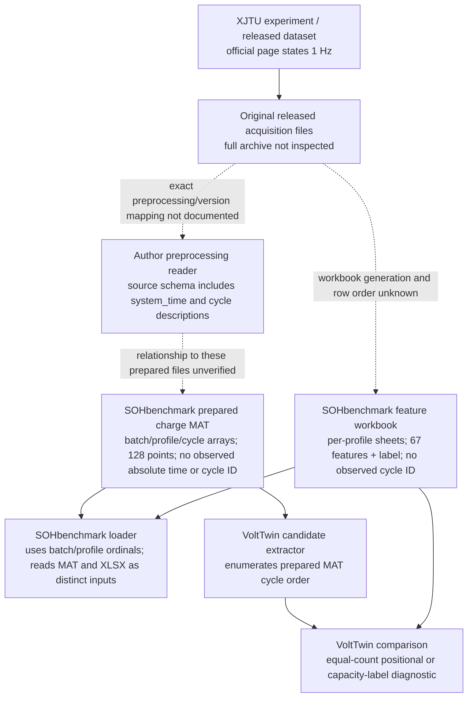

# XJTU Cycle Identity and Benchmark Provenance Investigation

## Executive summary

**No authoritative cycle-to-workbook-row mapping was found.** The local
prepared MAT cycles and feature workbook rows do not contain a common explicit
cycle identifier or timestamp. The existing alignment helper still produces
useful diagnostic comparisons, but it does not establish same-cycle identity.

The audit examined 55 profiles across six batches: 27,535 prepared MAT cycles
and 26,937 feature workbook rows. Calling the existing alignment helper
unchanged yields 19,191 equal-count positional pairs and 7,129 batch-6
capacity-label diagnostic pairs. These are **not identity-verified pairs**.
There are 617 unmatched workbook rows (including 489 ambiguous rows) and
1,215 unmatched raw cycles in the batch-6 capacity-match cohort.

Capacity labels provide partial, non-unique corroboration. For the 19,191
equal-count observations in batches 1–5, 13,464 same-index labels match raw
cycle capacities within `1e-6`. Batch 1 agrees for all 3,211 positions; batches
2, 3, and 5 have 3,700/3,727, 4,602/4,608, and 1,951/1,975 such matches.
Batch 4 has none within `1e-6`; 4,256/5,670 are within `0.001`, and the maximum
same-index difference is about `0.04026`. These differences could reflect label
precision, a different capacity source, skipped/reordered observations, or
other preprocessing; available evidence cannot distinguish those causes.
Equal capacity values can recur, so even exact label agreement is not a
cycle identifier.

**Conclusion:** 0 cycle/workbook row pairs can be authoritatively verified
from the inspected material. Profile ordinals are independently corroborated
as a loader convention, not as physical battery IDs. Same-index and capacity
matches remain diagnostic.

## Research methodology

1. Read the prior formula, candidate validation, original-formula verification,
   author-CC diagnostic, and feature-error reports. The anticipated prior
   cycle-identity report was not present at
   `reports/member4_cycle_identity_investigation.md` before this work.
2. Inspected the Member 4 loader, model, validation helper, package README, and
   prior alignment audit. No existing alignment behavior was edited.
3. Inspected all local `charge/batch-*.mat` files and all six
   `handcraft_features/batch-*_features.xlsx` workbooks. Enumerated profile and
   row counts, struct fields, workbook columns, sample counts, labels,
   positional label differences, and the existing helper's matched, ambiguous,
   and unmatched records.
4. Retrieved the official XJTU dataset page, the Zenodo release metadata, the
   pinned author preprocessing code, and the pinned SOHbenchmark README and
   XJTU loader. Their roles are distinguished below: dataset protocol or loader
   behavior is not treated as proof of the Excel generator or row mapping.
5. Kept evidence classes separate: authoritative identity, independent
   corroboration, diagnostic evidence, ambiguous evidence, and unsupported
   mapping methods. Capacity labels were only compared where counts were equal;
   the audit does not make a positional comparison for unequal-length
   sequences.

The reproducible audit is
[identity_investigation.py](../scripts/member4_xjtu/cycle_identity/identity_investigation.py).
It calls the existing `_profile_pairs` helper unchanged for the existing
alignment summary. Same-index label comparisons are supplementary diagnostics
and do not alter or replace that helper.

## Sources inspected

| Source | Evidence inspected | What it establishes | What it does not establish |
|---|---|---|---|
| [Official XJTU dataset page](https://wang-fujin.github.io/) | Experimental overview and batch protocols | 55 batteries, six strategies/batches, acquisition stated as 1 Hz, and described cycling procedures | A mapping from a prepared MAT cycle index to a workbook row |
| [Zenodo XJTU dataset record](https://zenodo.org/records/10963339), [record metadata](https://zenodo.org/api/records/10963339) | Release description and file listing | The record is a dataset, states 1 Hz, refers to `Data Introduction.pdf`, and lists `Battery Dataset.zip` | A feature workbook, cycle-row join, or transformation into the local SOHbenchmark files. The archive was not downloaded for this task |
| [Author preprocessing repository at pinned commit](https://github.com/wang-fujin/Battery-dataset-preprocessing-code-library/tree/e986a74054fb64c0f5134f2cc97f4643cd7699d2), [`XJTUBatteryClass.py`](https://github.com/wang-fujin/Battery-dataset-preprocessing-code-library/blob/e986a74054fb64c0f5134f2cc97f4643cd7699d2/XJTUBatteryClass.py) | Repository README and cycle reader/accessor | The author reader describes an original-source representation with ordered cycle entries, `system_time`, `relative_time_min`, signal channels, and per-cycle descriptions; the accessor uses a 1-based cycle position | That this reader generated the local `charge/batch-N.mat` files or the handcrafted feature workbook rows |
| [SOHbenchmark repository at pinned commit](https://github.com/wang-fujin/SOHbenchmark/tree/62230dd9a857f5c05ac641227b52ec2ffbeb9e15), [`XJTU_loader.py`](https://github.com/wang-fujin/SOHbenchmark/blob/62230dd9a857f5c05ac641227b52ec2ffbeb9e15/dataloader/XJTU_loader.py), [README](https://github.com/wang-fujin/SOHbenchmark/blob/62230dd9a857f5c05ac641227b52ec2ffbeb9e15/README.md) | MAT and workbook loader paths | The README describes files under `data` as preprocessed. The loader assigns battery IDs by array/sheet order and reads feature workbooks by sheet order | A documented cycle-level correspondence between raw/prepared MAT and Excel rows; a feature-generation implementation |
| Local prepared data | Six `charge/batch-N.mat` files, six feature workbooks, and SOHbenchmark loader | Exact fields/counts and how the benchmark code consumes the files | Provenance of omitted cycle IDs/timestamps, any deletion/reordering history, or generation method for the workbook |
| Prior Member 4 reports | Formula research, candidate validation, original-formula verification, author-CC diagnostic, feature-error analysis | Prior matching counts, uncertainty labels, candidate-only feature results, and known provenance gaps | Additional identity evidence beyond the listed sources |

The Zenodo record exposes one large archive file, and the official page refers
to a `Data Introduction.pdf`. That PDF was not found as a separate local file or
as a separate Zenodo record file in the inspected metadata; no claim is made
about uninspected contents inside the archive.

## Local data structure findings

| Layer | Observed structure | Explicit cycle identifier / timestamp? |
|---|---|---|
| Prepared MAT filename | `charge/batch-1.mat` through `batch-6.mat` | Batch encoded only |
| Prepared MAT top level | `battery` array; 55 profiles total | Profile is array ordinal, not a stored battery ID |
| Prepared MAT profile | `cycles` array | Cycle position is implicit in array order |
| Prepared MAT cycle | `relative_time_min`, `voltage_V`, `current_A`, `temperature_C`, scalar `capacity`; 128 signal samples in inspected files | No cycle counter, absolute timestamp, or description field observed |
| Feature workbook | `batch-N_features.xlsx`, sheets in `Sheet1`… ordinal form; 67 feature columns plus `label` | No cycle ID or timestamp column observed |
| Author reader's source-cycle interface | `system_time`, relative time, V/I/capacity/power/temperature, description, cycle accessed by 1-based array index | Has more context than prepared MAT, but no documented link to the workbook row |

These are schema observations for the local prepared files, not proof about
every file in the full original archive. The current VoltTwin loader creates
`cycle_index` using `enumerate` over the prepared MAT cycle array; that is a
local ordinal, not a source-provided cycle identifier.

## Mapping methods and confidence

| Mapping method | Classification | Evidence and result | Limitation |
|---|---|---|---|
| Explicit cycle ID | **Unsupported** | No explicit cycle ID field/column in local prepared cycles or workbook sheets | The original archive may preserve metadata not present in the prepared files |
| Author-provided mapping file / workbook generation join | **Unsupported** | No such mapping was located in inspected code, documents, or local data | Private, deleted, inaccessible, or unindexed materials cannot be ruled out |
| Filename and profile ordinal | **Independently corroborated — profile level only** | Filenames identify batch; SOHbenchmark loader uses the same 1-based ordinal convention for MAT battery arrays and feature sheets | Ordinal consistency is not an authoritative physical battery ID and says nothing about cycle-row joins |
| Timestamp | **Unsupported in prepared MAT/workbooks** | No absolute timestamp in local prepared MAT cycle fields or workbook columns. The author reader's separate source representation has `system_time` | No verified preservation/join from source timestamps to prepared files/workbook |
| Charge/discharge event sequence | **Diagnostic only** | Official documentation describes batch protocols; prepared files contain ordered charge traces | Workbook rows have no event key and batch protocol cannot identify a row-cycle pair |
| Capacity-label matching | **Diagnostic only; ambiguous where repeated** | Raw cycle scalar capacity can be compared with workbook `label`; batch-6 existing helper matches 7,129 rows | Capacity is not unique; repeated values, precision, skipped rows, and label-generation differences prevent identity proof |
| Equal-count positional pairing | **Diagnostic only** | Existing helper pairs equal indices for 19,191 rows in batches 1–5 | Equal lengths do not establish common origin, ordering, or absence of omissions |

No method meets the **authoritatively verified** class for cycle-to-workbook
row identity. Capacity evidence independently corroborates some positions but
does not upgrade those pairs to verified identity.

## Alignment and unmatched/ambiguous summary

| Batch | Profiles | Raw cycles | Workbook rows | Existing helper pairs | Method | Unmatched workbook rows | Ambiguous rows (subset) | Unmatched raw cycles |
|---:|---:|---:|---:|---:|---|---:|---:|---:|
| 1 | 8 | 3,211 | 3,211 | 3,211 | equal-count positional | 0 | 0 | 0 |
| 2 | 15 | 3,727 | 3,727 | 3,727 | equal-count positional | 0 | 0 | 0 |
| 3 | 8 | 4,608 | 4,608 | 4,608 | equal-count positional | 0 | 0 | 0 |
| 4 | 8 | 5,670 | 5,670 | 5,670 | equal-count positional | 0 | 0 | 0 |
| 5 | 8 | 1,975 | 1,975 | 1,975 | equal-count positional | 0 | 0 | 0 |
| 6 | 8 | 8,344 | 7,746 | 7,129 | monotone capacity diagnostic | 617 | 489 | 1,215 |
| **Total** | **55** | **27,535** | **26,937** | **26,320** | mixed, all unverified | **617** | **489** | **1,215** |

The 489 ambiguous workbook rows are included in the 617 unmatched workbook
rows, not additional to them. The 1,215 unmatched raw cycles are counted
separately. There are zero identity-verified pairs.

### Capacity-label positional cross-check

Only the 47 equal-count profiles (batches 1–5) are compared position by
position below. `matches` means absolute capacity-label difference at or below
the stated tolerance; it is not an identity decision.

| Batch | Equal-count observations | `|raw capacity - workbook label| ≤ 1e-6` | `≤ 0.0005` | `≤ 0.001` | Median absolute difference across profiles | Maximum absolute difference |
|---:|---:|---:|---:|---:|---:|---:|
| 1 | 3,211 | 3,211 | 3,211 | 3,211 | 0 | 0 |
| 2 | 3,727 | 3,700 | 3,700 | 3,700 | 0 | 0.054 |
| 3 | 4,608 | 4,602 | 4,602 | 4,602 | approximately 0 | 0.01308 |
| 4 | 5,670 | 0 | 2,687 | 4,256 | 0.000530 | 0.04026 |
| 5 | 1,975 | 1,951 | 1,951 | 1,951 | approximately 0 | 0.05073 |
| **Total** | **19,191** | **13,464** | **16,151** | **17,720** | — | — |

Exact matches in many positions are useful corroboration, but repeated capacity
values can belong to distinct cycles and some positions have substantial
label differences. Batch 4's pattern may involve workbook rounding or a
different label source; the existing evidence cannot resolve that. No
capacity-based alignment rule was changed.

## Data lineage reconstruction



### Known and unknown stages

| Stage | Status |
|---|---|
| Dataset experiment, batch strategies, 1 Hz rate statement | **Known from official dataset page/release metadata** |
| Original released files and their cycle-level metadata | **Partially documented** by author reader; full archive not inspected |
| Transformation from original files to local 128-point prepared MAT | **Unknown**: exact script/version, omissions, resampling, and retained IDs/timestamps not established |
| Feature workbook generator and its raw input | **Unknown**: SOHbenchmark loader consumes the workbook; no source generator found |
| Workbook row-to-prepared-MAT cycle join | **Unknown**: no explicit key or authoritative mapping |
| Current VoltTwin candidate extraction | **Known implementation**, but candidate formulas are not original benchmark formulas |
| Current candidate-to-workbook matching | **Known diagnostic behavior**, not a verified identity join |

## Implications for prior results

### Conclusions that remain valid

- The local file counts, schemas, workbook values, candidate outputs, helper
  alignment counts, and numerical differences for the pairs actually compared
  are reproducible observations.
- Existing candidate MAE/RMSE and related summary values describe those
  selected pairs. They remain descriptive comparisons between workbook values
  and candidate values under the recorded matching rule.
- The result that no original feature generator/formula has been located is
  unaffected by cycle identity evidence.

### Conclusions that cannot be treated as same-cycle or causal

- Per-cycle residuals cannot be interpreted as errors for a known physical
  cycle when the join is unverified.
- Batch/profile/cycle-range error clusters may reflect pairing differences,
  omitted cycles, label precision, or a feature mismatch; they cannot identify
  a formula root cause.
- Entropy proxy-versus-workbook differences remain a real numeric discrepancy
  for compared rows, but cannot yet be attributed to an entropy equation
  mismatch on the same cycle.
- Low relative error does not validate formulas or cycle identity; high error
  does not prove a candidate implementation bug.
- Candidate feature validation claims must remain explicitly unverified.
- Raw-derived feature experiments paired to workbook SOH labels inherit the
  same join limitation. Benchmark experiments using the workbook and its own
  labels do not require a raw-cycle join, but they do not validate raw feature
  extraction.

## Research gaps and recommended next steps

1. Obtain the complete original archive or the dataset authors' `Data
   Introduction.pdf`; inspect original file names, cycle descriptions,
   timestamps, and any documented battery/cycle numbering.
2. Request from dataset/SOHbenchmark authors the exact versioned
   preprocessing and workbook-generation scripts, including row filtering,
   resampling, battery ordering, and raw-cycle-to-feature-row correspondence.
3. If source records retain `system_time` or cycle descriptions, establish a
   join against both outputs with documented transformations and duplicate /
   missing-record handling. Preserve ambiguity rather than forcing a match.
4. Re-run feature-error analysis only on authoritatively mapped observations.
   Keep unresolved rows and existing diagnostic results separate.
5. Until that evidence exists, keep all current positional and capacity
   matches labeled diagnostic and do not claim exact benchmark reproduction.

## Reproducible artifacts

- [Audit runner](../scripts/member4_xjtu/cycle_identity/identity_investigation.py)
- [Audit README](../scripts/member4_xjtu/cycle_identity/README.md)
- [Isolated tests](../tests/member4_xjtu/cycle_identity/test_identity_investigation.py)
- [Profile-level audit](./member4_cycle_identity_investigation/profile_audit.csv)
- [Mapping evidence table](./member4_cycle_identity_investigation/mapping_evidence.csv)
- [Schema inventory](./member4_cycle_identity_investigation/schema_inventory.csv)
- [Unmatched rows and cycles](./member4_cycle_identity_investigation/unmatched_rows_and_cycles.csv)
- [Summary counts](./member4_cycle_identity_investigation/summary.json)

Run the audit from the repository root with:

```powershell
.\.venv\Scripts\python.exe -m scripts.member4_xjtu.cycle_identity.identity_investigation
```

It reads the existing dataset, leaves it unchanged, and regenerates the
machine-readable files in `reports/member4_cycle_identity_investigation/`.
