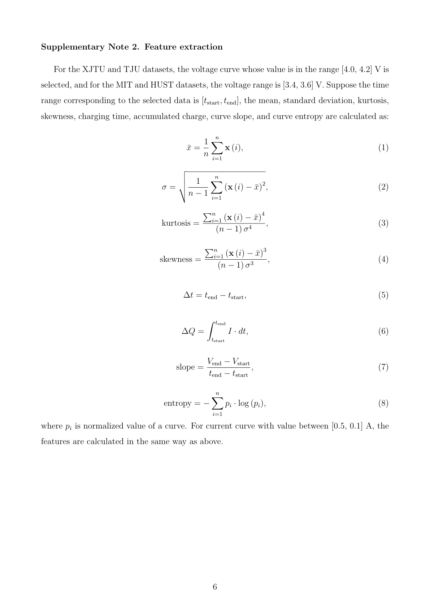

# XJTU Supplementary PDF Inspection

## Executive finding

The two named files in `C:\Users\acer\Downloads` were present, but neither could be rendered or parsed as a complete PDF: PyMuPDF reported zero pages and pypdf reported an unexpected end of stream. Their embedded metadata identifies the **main article**, not the supplementary information. I therefore did not treat either local file as page evidence.

I retrieved the publisher-hosted supplementary PDF for Wang et al. (2024), inspected all 15 pages for relevant terms, and visually inspected rendered pages 3, 5, 6, and 7. Supplementary Note 2 on printed page 6 does provide equations for the 2024 paper's own short-window feature method. It does **not** identify those equations as the source of the SOHbenchmark Excel's 67 columns.

**Conclusion:** the supplement contains related methodology, but no direct mapping to the benchmark's 67-feature schema. No one of the 67 benchmark features is Source Verified by this document. The equations below are evidence for the 2024 paper's method only; they must not be substituted for or labeled as original Excel formulas.

## Files and inspection method

| Input | Result |
|---|---|
| `s41467-024-48779-z (1).pdf` | Present, 8,732,355 bytes; metadata title is the main article; no `%%EOF` marker; PyMuPDF page count 0; pypdf reports an unexpected end of stream. |
| `s41467-024-48779-z.pdf` | Present, 1,064,643 bytes; metadata title is the main article; no `%%EOF` marker; PyMuPDF page count 0; pypdf reports an unexpected end of stream. |
| Publisher supplementary PDF | Retrieved from the DOI-linked Springer static-content URL; valid 15-page PDF. SHA-256: `f6f0ee6ea624c959487ea680fefc97142cdd88135976201b6e498f780dbe0753`. |

The attachment checksums and parser observations are in [source_metadata.json](./member4_supplementary_pdf_inspection/source_metadata.json). The supplementary PDF was kept in the system temporary directory and was not copied into the repository. Page text was scanned page by page. Relevant pages were rendered at 2x and inspected as images; rendered evidence is included below and in the evidence directory.

## Source references

| Source | Evidence and authority | Scope limitation |
|---|---|---|
| [Wang et al. (2024), Nature Communications 15, 4332](https://doi.org/10.1038/s41467-024-48779-z) | The paper's own method; Supplementary Note 2 states the selection windows and equations. | Does not state that this is the generator for SOHbenchmark's 67 Excel columns. |
| [Publisher supplementary PDF](https://static-content.springer.com/esm/art%3A10.1038%2Fs41467-024-48779-z/MediaObjects/41467_2024_48779_MOESM1_ESM.pdf) | Inspected rendered pages and page text, especially pp. 3-7. | Formula and protocol evidence applies to this paper's method only. |
| [Author PINN4SOH repository at commit `cc3cc5053caf38f04e0665f7f88cb109144d035e`](https://github.com/wang-fujin/PINN4SOH/tree/cc3cc5053caf38f04e0665f7f88cb109144d035e) | The supplement's p. 7 `code link` resolves to this author repository. Its README describes the data directory as preprocessed data. | The inspected code consumes prepared CSV data; it does not establish a generator for the 67-column SOHbenchmark workbook. |
| [PINN4SOH XJTU CSV](https://github.com/wang-fujin/PINN4SOH/blob/cc3cc5053caf38f04e0665f7f88cb109144d035e/data/XJTU%20data/RW_battery-7.csv) and [loader](https://github.com/wang-fujin/PINN4SOH/blob/cc3cc5053caf38f04e0665f7f88cb109144d035e/dataloader/dataloader.py) | The CSV header contains 16 paper-specific feature columns plus `capacity`; the loader reads CSV files. | This is a separate schema and prepared data, not evidence that similar-looking benchmark columns share formulas. |
| Local benchmark workbooks under `reference/SOHbenchmark/data/XJTU/handcraft_features/` | The target schema consists of 67 named features plus a label in the existing workbooks. | No workbook generator or mapping to the paper's 16-feature schema is supplied by the supplement. |

## Equations actually shown (Supplementary Note 2, printed p. 6)

The note says that for XJTU and TJU it selects voltage-curve values in `[4.0, 4.2] V`; for MIT and HUST it uses `[3.4, 3.6] V`. Let the selected samples correspond to `[t_start, t_end]`. It then gives:

1. **Mean**
   \[
   \bar{x} = \frac{1}{n}\sum_{i=1}^{n}x^{(i)}
   \]
2. **Standard deviation**
   \[
   \sigma = \sqrt{\frac{1}{n-1}\sum_{i=1}^{n}(x^{(i)}-\bar{x})^2}
   \]
3. **Kurtosis**
   \[
   \mathrm{kurtosis} =
   \frac{\sum_{i=1}^{n}(x^{(i)}-\bar{x})^4}{(n-1)\sigma^4}
   \]
4. **Skewness**
   \[
   \mathrm{skewness} =
   \frac{\sum_{i=1}^{n}(x^{(i)}-\bar{x})^3}{(n-1)\sigma^3}
   \]
5. **Selected-window duration**
   \[
   \Delta t = t_{\mathrm{end}} - t_{\mathrm{start}}
   \]
6. **Accumulated charge**
   \[
   \Delta Q = \int_{t_{\mathrm{start}}}^{t_{\mathrm{end}}} I \cdot dt
   \]
7. **Endpoint voltage slope**
   \[
   \mathrm{slope} =
   \frac{V_{\mathrm{end}}-V_{\mathrm{start}}}
        {t_{\mathrm{end}}-t_{\mathrm{start}}}
   \]
8. **Curve entropy**
   \[
   \mathrm{entropy} = -\sum_{i=1}^{n}p_i\log(p_i)
   \]

The note says that \(p_i\) is the “normalized value of a curve.” It then says that for the current curve with value between **`[0.5, 0.1] A`** the features are calculated in the same way. That interval is transcribed in the order printed; this report does not silently reorder or reinterpret it.

### What the equations establish—and what they do not

- They establish the generic statistic conventions above **for the paper's selected curves**. In particular, the printed standard deviation uses \(n-1\), and the printed skewness and kurtosis denominators also use \(n-1\).
- The paper describes a voltage-value window and a current-value window. The note does not define the 67 workbook's CC, CV, dV, dI, or full-charge phase boundaries. The batch protocol descriptions on pp. 3-4 mention CC-CV charging, but do not say the equation windows are those phases.
- The note gives no time unit, sampling rate, resampling/filtering rule, endpoint inclusion rule, numerical integration implementation, or explicit handling of missing samples.
- For entropy, it does not define whether \(p_i\) is a probability mass or a normalized sample value, how values are normalized, the log base, treatment of zeros, or any binning. Thus it does not validate the candidate 16-bin histogram proxy.
- The supplement does not give a power/energy equation, a temperature-statistic formula, a derivative of current, or a feature-specific derivation for all 67 benchmark names.
- Although \(\Delta Q\), \(\Delta t\), slope, and generic statistics resemble some benchmark feature concepts, resemblance is not evidence that the benchmark uses these equations.

## Comparison with the author's linked code schema

The linked PINN4SOH XJTU CSV has these 16 input-feature headers:

`voltage mean`, `voltage std`, `voltage kurtosis`, `voltage skewness`, `CC Q`, `CC charge time`, `voltage slope`, `voltage entropy`, `current mean`, `current std`, `current kurtosis`, `current skewness`, `CV Q`, `CV charge time`, `current slope`, `current entropy`

It also has the `capacity` target column. This 17-column CSV schema is not the 67-column SOHbenchmark schema. Some labels are conceptually similar (for example, `CC Q` and a benchmark `CC_Q`), but neither the equation note nor the CSV header ties that paper-specific column to the Excel column. The repository README calls its data preprocessed, and its loader consumes CSVs; this evidence does not expose the original feature-generation steps.

## Feature mapping summary

The detailed 67-row table is [feature_mapping.csv](./member4_supplementary_pdf_inspection/feature_mapping.csv). All rows explicitly say that no exact 67-feature match was established.

| Potential connection to p. 6 method | Benchmark features screened | Classification |
|---|---|---|
| Generic voltage/current mean, standard deviation, skewness, or kurtosis | 24 features whose existing candidate description uses voltage or current and one of these operators | Related methodology only; the source windows and workbook identity are not established. |
| Accumulated charge \(\Delta Q\) | `CC_Q`, `dV_Q`, `CV_Q`, `dI_Q`, `Charge_Q` | Related methodology only; no original segment or workbook mapping. |
| Selected interval duration \(\Delta t\) | `CC_CCCT`, `CV_CVCT` | Related methodology only; not evidence of the workbook's CC/CV boundary rules. |
| Endpoint voltage slope | `dV_dV_devide_dt` | Related methodology only; the paper does not identify this named workbook column. |
| Generic curve entropy | `CC_entropy`, `dV_entropy`, `CV_entropy`, `dI_entropy` | Related methodology only; estimator details remain ambiguous and do not establish the workbook estimator. |
| No feature-level correspondence in the inspected supplement | 31 remaining features, including energy features, time-mean fields, temperature statistics, and `dI_dI_devide_dt` | No feature-level correspondence located. |

`candidate_signal_used_for_screening_only` in the CSV is taken from the existing candidate evidence ledger and is used only to identify possible mathematical overlap. It is not original-source evidence and does not change any feature status.

## Page-wise evidence

| PDF page | Content inspected | Relevance |
|---:|---|---|
| 1 | Article title and authors | Identifies the paper; no 67-feature schema. |
| 2 | Figure S.1 laboratory platform and battery parameters | Experimental context only. |
| 3 | Supplementary Note 1, batch protocol descriptions | Protocol context; CC-CV charging is mentioned but not used to specify the p. 6 feature windows. |
| 4 | Supplementary Note 1.6 continuation | Satellite/GEO discharge context; no feature equations. |
| 5 | Figure S.4 voltage, current, temperature, and capacity trajectories for XJTU | Shows signals and reports capacity interpolation for batches 3-6; not feature extraction equations. |
| 6 | Supplementary Note 2, equations (1)-(8) | Direct evidence for the 2024 paper's feature method; no direct 67-column mapping. |
| 7 | Table S.2 and code link | Battery counts and PINN4SOH link; the MATLAB-order note specifically concerns MIT data, not XJTU workbook alignment. |
| 8 | Table S.3 XJTU model results | Model evaluation, not feature formulas. |
| 9 | Table S.4 TJU model results | Model evaluation, not feature formulas. |
| 10 | Table S.5 HUST model results | Model evaluation, not feature formulas. |
| 11 | Table S.6 MIT model results | Model evaluation, not feature formulas. |
| 12 | Table S.7 XJTU small-sample results | Model evaluation, not feature formulas. |
| 13 | Figure S.5 XJTU RMSE distributions | Model evaluation, not feature formulas. |
| 14 | Supplementary Note 3 and Table S.8 model details | Model architecture and settings, not feature equations. |
| 15 | References | No 67-feature definitions. |

Machine-readable page notes are in [pagewise_evidence.csv](./member4_supplementary_pdf_inspection/pagewise_evidence.csv).

## Rendered page evidence

The screenshots are publisher-PDF page renders. Page 6 shows the equations as printed; pages 3, 5, and 7 provide protocol, figure-caption, and code-link context.

Additional renders: [page 3](./member4_supplementary_pdf_inspection/page_03.png), [page 5](./member4_supplementary_pdf_inspection/page_05.png), and [page 7](./member4_supplementary_pdf_inspection/page_07.png).

## Final determination

1. **Was the exact 67-feature Excel schema explicitly defined?** No, not in this supplement.
2. **Were useful original equations found?** Yes: equations for the separate 2024 PINN paper's selected-window statistics, accumulated charge, duration, voltage slope, and curve entropy.
3. **Are any of the benchmark's 67 features verified by this evidence?** No. The closest cases are related methodology only; the source does not connect them to the benchmark workbook or establish matching segment/preprocessing conventions.
4. **Does this establish genuine reproduction of the SOHbenchmark feature workbooks?** No. It gives a plausible, source-backed method for a different feature schema, not the original workbook generator.

No existing feature implementation, metadata, or prior report was changed. The new artifacts are limited to this report and `reports/member4_supplementary_pdf_inspection/`.
